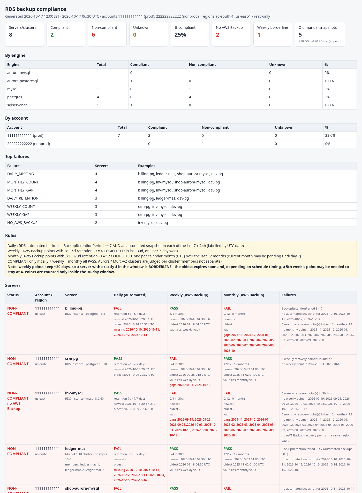

# rds_backup_compliance_report.sh

A **read-only** backup compliance report for RDS instances, Aurora clusters and Multi-AZ DB clusters. It covers several accounts (profiles) and regions. For every database it checks three things:

* **Daily** backups (RDS automated backups)
* **Weekly** backups (AWS Backup)
* **Monthly** backups (AWS Backup)

It marks each database **COMPLIANT** only when all three checks pass. Databases with no AWS Backup coverage are flagged. It also lists **manual snapshots older than 90 days**, with age, size, an approximate monthly cost and an orphan flag, and prints the delete commands for them. **The delete commands are printed only. The script never runs them.**

Output formats are text, CSV, JSON and a single-file HTML report. The summary comes first, and run times are shown in both IST and UTC.

```bash
./rds_backup_compliance_report.sh -P prod,nonprod -r us-east-1,ap-south-1                    # text to the screen
./rds_backup_compliance_report.sh -P prod,nonprod -r us-east-1,ap-south-1 -F txt,csv,html,json -o ~/backup_compliance
```



* **Scope:**
  * RDS instances: postgres, mysql, mariadb, sqlserver-\*, oracle-\*, db2-\*. Each instance is judged on its own.
  * Aurora clusters (aurora-postgresql / aurora-mysql) and Multi-AZ DB clusters are judged **per cluster**. Members are listed under the cluster, not as separate rows.
  * Read replicas are skipped and counted (`--include-replicas` judges them as well).
  * DocumentDB and Neptune are ignored.
* **Strictly read-only:** only `describe-*` / `list-*` calls (listed below). As a second safety net, `aws_call` refuses any operation that is not `describe-*` / `list-*` / `get-*`.
* **Requirements:**
  * Bash 4.4+, AWS CLI v2 and jq 1.6+.
  * Keep `lib/backup_compliance.jq` next to the script.

## The rules

| Check | Source | PASS when (defaults; all configurable) |
|---|---|---|
| **Daily** | RDS automated backups (`describe-db-snapshots` / `describe-db-cluster-snapshots --snapshot-type automated`, `BackupRetentionPeriod`) | `BackupRetentionPeriod >= 7` **and** an automated snapshot in **each of the last 7 × 24 h** windows. Missing days are reported by UTC date. |
| **Weekly** | AWS Backup recovery points with **28–35 day** retention | **>= 4 COMPLETED** points created in the **last 30 days**, and **one in each 7-day week** (gaps reported). |
| **Monthly** | AWS Backup recovery points with **360–370 day** retention | **>= 12 COMPLETED**, **one per calendar month (UTC)** over the last 12 months. The current month counts as *pending*, not as a gap, until day 7 (`--monthly-grace-days`). |
| **Overall** | | **COMPLIANT** = daily + weekly + monthly all PASS. **NON-COMPLIANT** = any FAIL. **UNKNOWN** = a listing failed (e.g. access denied) and nothing failed. |

**How recovery points are classified.** Retention days come from `Lifecycle.DeleteAfterDays`. When that is missing, they come from `CalculatedLifecycle.DeleteAt − CreationDate`, rounded to whole days. Points that match neither range are ignored, for example 7-day "daily" AWS Backup points or 90-day points. If you also want points classified by plan rule name, add `--rule-name-fallback`. Points whose retention matches neither range are then classified by `CreatedBy.BackupRuleName`: `/(?i)week/` means weekly and `/(?i)month/` means monthly. Both patterns can be changed with `--weekly-rule-regex` / `--monthly-rule-regex`. Only points created after about 13 months ago are fetched (`--by-created-after`).

**Weekly borderline note.** Weekly points are kept for about 30 days, so the count inside the 30-day window moves between 4 and 5 as points expire. A server with **exactly 4** passes but is marked **BORDERLINE**, together with the next expiry time. Depending on schedule timing, a missed or late job will drop it to 3. Only points inside the window are counted. Older points that have not been deleted yet do not count.

**No AWS Backup coverage.** A server is flagged `NO_AWS_BACKUP` when there is no AWS Backup recovery point for its ARN in any vault in the same region. Such a server also fails weekly and monthly.

Failure codes, which feed the "Top failures" summary: `DAILY_RETENTION`, `DAILY_MISSING`, `WEEKLY_COUNT`, `WEEKLY_GAP`, `MONTHLY_COUNT`, `MONTHLY_GAP`, `NO_AWS_BACKUP`.

## Old manual snapshots

* **What is listed:** manual instance snapshots and manual cluster snapshots (`--snapshot-type manual`) older than `--max-manual-age` (default 90 days).
  * Snapshots taken by AWS Backup (`awsbackup:*`) are excluded.
  * Snapshots shared from other accounts are not listed.
* **Columns:** age, size (GB), source, engine, an **approximate** monthly cost and an **orphan** flag.
  * Size is `AllocatedStorage` and cost = size × `--price-per-gb` (default **$0.095/GB-month**). Both are approximate, because real billing is incremental.
  * An orphan is a snapshot whose source instance or cluster no longer exists in that region.
* **Delete commands are printed only and never executed:**
  * `aws rds delete-db-snapshot --db-snapshot-identifier 'X' --region R --profile 'P'`
  * `aws rds delete-db-cluster-snapshot --db-cluster-snapshot-identifier 'X' --region R --profile 'P'`

  Review them before you run anything yourself.

## Output

* **Summary at the top:**
  * overall compliant / non-compliant / unknown counts and % compliant
  * pass counts per check, borderline weekly and no-AWS-Backup counts
  * per **engine** and per **account** breakdown
  * **top failures** (count and examples)
  * **old manual snapshot totals** (count, GB, approx $/month, orphans)
* **Then:** the rules, then every server, NON-COMPLIANT first. For each check it shows the result, the newest and oldest backup, the vault, and any gaps or missing dates. The old manual snapshots come next, each with its delete command, and any AWS errors are listed last.
* **Files:** with `-o DIR`, files are named `<prefix>_YYYYmmdd_HHMMSS.<ext>`. `-F csv` writes three CSVs:
  * `.csv`: one row per server, with tag columns
  * `_manual_snapshots.csv`
  * `_summary.csv`: overall, engine, account, failure and manual rows
* **Samples:** [txt](samples/sample_report.txt), [html](samples/sample_report.html), [json](samples/sample_report.json), [csv](samples/sample_report.csv), [manual csv](samples/sample_report_manual_snapshots.csv), [summary csv](samples/sample_report_summary.csv). They were generated from the mock fleet.

Sample (text, top of the report):

```
RDS BACKUP COMPLIANCE REPORT  (rds_backup_compliance_report.sh v1.0.0, read-only)
Generated: 2026-10-17 12:00 IST | 2026-10-17 06:30 UTC
Accounts : 111111111111 (prod), 222222222222 (nonprod)
Regions  : ap-south-1, us-east-1

== SUMMARY
OVERALL  : 8 servers/clusters | COMPLIANT 2 | NON-COMPLIANT 6 | UNKNOWN 0 | 25% compliant
Checks   : daily PASS 4/8 | weekly PASS 5/8 (borderline 1) | monthly PASS 4/8 | no AWS Backup coverage: 2
...
Top failures:
  DAILY_MISSING    4    server(s)  e.g. billing-pg, ledger-maz, shop-aurora-mysql, dev-pg
  ...
Old manual snapshots (> 90d): 5 | 950 GB | ~$90.25/month (approximate, $0.095/GB-month) | orphaned 2 (580 GB) | oldest 400d

== SERVERS (8)  status | daily | weekly | monthly
!! NON-COMPLIANT 111111111111/us-east-1 Aurora cluster: shop-aurora-mysql [aurora-mysql 8.0.mysql_aurora.3.08.2]
     daily   FAIL retention 7d, 5/7 days, ..., MISSING 2026-10-11,2026-10-14
     weekly  ok   4 in 30d (need >= 4), ..., vault rds-weekly-vault, BORDERLINE (next expiry 2026-10-24 04:30 UTC)
     monthly FAIL 11 (need >= 12), 11/12 month(s), ..., GAPS 2026-06
```

## Options

| Option | Meaning |
|---|---|
| `-P, --profile` | profiles / accounts (repeatable, comma list; default credential chain) |
| `-r, --region` / `-A, --all-regions` | regions, or every enabled region per account |
| `-e, --engine GLOB`, `-i, --identifier GLOB` | filters (a cluster matches by member too) |
| `--include-replicas` | judge read replicas too |
| `--min-retention N` (7), `--daily-days N` (7) | daily rule |
| `--weekly-retention MIN-MAX` (28-35), `--weekly-window N` (30), `--weekly-required N` (4) | weekly rule |
| `--monthly-retention MIN-MAX` (360-370), `--monthly-required N` (12), `--monthly-grace-days N` (7) | monthly rule |
| `--rule-name-fallback`, `--weekly-rule-regex`, `--monthly-rule-regex` | classify by backup rule name when retention does not match |
| `--max-manual-age N` (90), `--price-per-gb P` (0.095) | manual snapshots |
| `-F txt,csv,json,html`, `-o DIR`, `--prefix`, `-T tag,cols`, `--top N`, `--tz ZONE` (Asia/Kolkata) | report |
| `--non-compliant-only`, `--fail-on-noncompliant` (exit 5) | listing / CI |
| `--config FILE` | key=value file, **parsed, never sourced**; CLI overrides; credentials refused ([example](rds_backup_compliance_report.conf.example)) |
| `--dry-run`, `--keep-workdir`, `-v`, `-l FILE`, `--aws-timeout`, `--max-attempts` | behaviour |

Exit codes:

* `0`: report produced
* `5`: non-compliant servers found (only with `--fail-on-noncompliant`)
* `1`: usage error
* `2`: pre-check failed, or no usable profile
* `4`: output error
* `130`: interrupted

## Examples

```bash
# all prod regions, files for the audit folder
./rds_backup_compliance_report.sh -P prod -A -F txt,csv,html -o ~/backup_compliance

# only Aurora, only failures, fail a CI job when anything is non-compliant
./rds_backup_compliance_report.sh -P prod -r us-east-1 -e 'aurora-*' --non-compliant-only --fail-on-noncompliant

# plans with 31-day weekly / 13-month monthly retention, rule-name fallback, cheaper archive price
./rds_backup_compliance_report.sh -P prod -r ap-south-1 --weekly-retention 28-31 --monthly-retention 360-400 \
    --rule-name-fallback --price-per-gb 0.021

# config file + cron (one line)
30 2 * * * /opt/dba/RDS_Backup_Compliance/rds_backup_compliance_report.sh --config /opt/dba/backup.conf >>/var/log/rds_backup_compliance.log 2>&1

# what would be called, no AWS calls
./rds_backup_compliance_report.sh -P prod,nonprod -r us-east-1 --dry-run
```

## Required IAM permissions (read-only)

```json
{
  "Version": "2012-10-17",
  "Statement": [{
    "Sid": "RdsBackupComplianceReadOnly",
    "Effect": "Allow",
    "Action": [
      "sts:GetCallerIdentity",
      "ec2:DescribeRegions",
      "rds:DescribeDBInstances",
      "rds:DescribeDBClusters",
      "rds:DescribeDBSnapshots",
      "rds:DescribeDBClusterSnapshots",
      "backup:ListBackupVaults",
      "backup:ListRecoveryPointsByBackupVault"
    ],
    "Resource": "*"
  }]
}
```

* `ec2:DescribeRegions` is only needed for `--all-regions`.
* The AWS managed policies `ReadOnlyAccess`, or `AWSBackupAuditAccess` + `AmazonRDSReadOnlyAccess`, also cover these actions.
* If backup vault access policies deny listing, the affected servers show weekly / monthly as **UNKNOWN**, and the error is listed at the end of the report.

AWS calls per profile and region:

* `sts get-caller-identity`, plus `ec2 describe-regions` (only with `--all-regions`)
* `rds describe-db-clusters`, `rds describe-db-instances`
* `rds describe-db-snapshots --snapshot-type automated|manual`
* `rds describe-db-cluster-snapshots --snapshot-type automated|manual`
* `backup list-backup-vaults`, then `backup list-recovery-points-by-backup-vault --backup-vault-name V --by-created-after T` once per vault

AWS CLI v2 follows pagination automatically.

## Tests

* `tests/run_tests.sh`: 120 checks against `tests/mock/aws`, a Python stub that has no network code. The stub refuses any write operation (exit 99). A guard aborts the run unless the mock is the `aws` on PATH. The tests use fake credentials, a dead endpoint (`127.0.0.1:9`), a fixed clock, and a temp directory as output, and they assert that the repo tree is unchanged afterwards. Coverage:
  * every rule and boundary, including retention 3/7/14, missing days, a borderline exactly-4 weekly, a weekly gap with a PARTIAL job, a missing month, the month grace period, `CalculatedLifecycle`-only points, rule-name fallback and wider retention ranges
  * Aurora / Multi-AZ clusters, replicas and docdb being ignored
  * manual snapshot age, cost, orphan and `awsbackup:` exclusion
  * access denied and failed listings (UNKNOWN), bad credentials and multi-profile runs
  * all formats, config parsing (a `$(...)` value is never executed, credentials are refused), dry run with zero calls, only describe/list operations being called
  * 1500 servers in about 10 s
  * shellcheck
* `tests/validate_cli.sh`: checks against the **real AWS CLI v2**, never AWS.
  1. Every distinct command line the script issued is replayed through the real CLI. It runs with fake credentials and a dead loopback endpoint, so a "Could not connect" result means the CLI accepted it. Negative controls must be rejected, and a guard refuses any real call without a 127.0.0.1 endpoint.
  2. The mock responses must match `--generate-cli-skeleton output`.
  3. The printed delete commands must be valid syntax. This check also runs only against the dead endpoint.
  4. End to end: a full run through the real CLI against `tests/fake_aws_endpoint.py`. That fake endpoint speaks RDS/STS query XML and AWS Backup REST-JSON, and pages every list. The counts must match what the fake endpoint expects: 121 servers, 93 compliant and 45 old manual snapshots.

## Caveats

* **Same-region vaults only:** a point copied to another region or account is not counted for the source. The source is flagged `NO_AWS_BACKUP` if it has no same-region points.
* **UTC throughout:** daily windows are rolling 24 h windows labelled with the expected UTC snapshot date, using the backup window time. Calendar months are UTC months too.
* **Costs are estimates:** they use allocated GB × price. Aurora and incremental snapshot billing differ, so use Cost Explorer for exact figures.
* **Multi-AZ DB clusters** are judged like Aurora clusters: cluster automated snapshots plus cluster retention.
