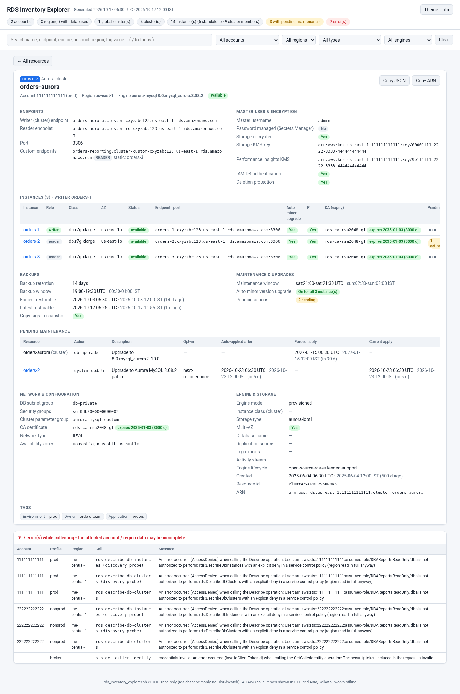

# RDS_Inventory_Explorer

`rds_inventory_explorer.sh` is a **read-only** Bash / AWS CLI v2 script that writes **one self-contained HTML file** of your RDS and Aurora fleet across accounts (profiles) and regions. It covers Aurora global clusters, regional Aurora clusters and Multi-AZ DB clusters, and RDS instances (standalone, read replicas and cluster members). Open the file, type or pick a resource, and you see the full metadata for **that cluster or instance alone**.

- One file, no server, no internet needed. The data is embedded in the page and nothing is loaded from the network (CSP `default-src 'none'`).
- **No CloudWatch, no secret values.** Only `sts get-caller-identity`, `ec2 describe-regions` and `rds describe-*` calls are made. The script refuses anything else (`read_only_guard`). It shows the ARN of a managed master secret, never its value.
- Errors in one account or region (AccessDenied, SCP, throttling, expired SSO) are recorded and shown in the page. They never stop the run.



A sample page built from the test mock is in [samples/sample.html](samples/sample.html). Download it and open it in a browser.

## Quick start

```bash
# all enabled regions of two accounts; empty regions are skipped by a quick probe
./rds_inventory_explorer.sh -P prod,dev -A -o ~/rds_inventory

# one account, two regions
./rds_inventory_explorer.sh -P prod -r us-east-1,ap-south-1

# see the exact AWS calls first, without calling anything
./rds_inventory_explorer.sh -P prod,dev -A --dry-run
```

The output is `<prefix>_YYYYmmdd_HHMMSS.html` (default prefix `rds_inventory_explorer`) with mode 0640. Requirements: Bash 4.4+, AWS CLI v2 and jq.

## How it works

1. **Arguments** are validated (regions, prefix, time zone, numbers). With `--dry-run` the call plan is printed and the script stops.
2. **Pre-check:** `aws` v2 and `jq` must be present.
3. **For each profile:**
   - `sts get-caller-identity` gives the account ID. If this call fails, the profile is recorded as an error and skipped. If no profile has valid credentials, the exit code is 2.
   - The region list comes from `-r`, the profile or environment default, or with `-A` from `ec2 describe-regions`.
   - **Discovery (`-A`):** each region is probed in parallel (`--probe-parallel`, default 8) with 2 one-page calls: `describe-db-instances` and `describe-db-clusters` with `--max-records 20 --query 'length(...)' --no-paginate`.
     - Only regions with at least one instance or cluster are read in full.
     - A probe that fails (AccessDenied, SCP, timeout) is shown as an error, and that region is **still read in full**. A failed probe is never treated as an empty region.
     - `--no-discover` skips the probe.
   - **Each region is read in full** with `describe-db-clusters`, `describe-db-instances`, `describe-global-clusters`, `describe-db-cluster-endpoints` (only when the region has clusters), `describe-pending-maintenance-actions` and `describe-certificates`. All of them use the CLI's automatic pagination.
4. **Model:** `lib/explorer.jq` joins everything into one list of resources.
   - Global clusters are de-duplicated across regions.
   - Members are linked to their clusters, replicas to their sources, and pending actions and CA expiry to each resource.
   - Times are converted to UTC and the `--tz` zone (default Asia/Kolkata, IST).
   - DocumentDB and Neptune are dropped unless `--include-docdb` is given.
5. **HTML:** the model is embedded as JSON into `lib/explorer_template.html`. `<`, U+2028 and U+2029 are escaped, so a tag value like `</script>` cannot break the page. The file is written atomically.

## Using the page

- **Search box:** type-ahead over names, endpoints, engine, version, account, region and tag values. `/` focuses it, the arrow keys and Enter pick a suggestion, and Esc closes the list.
- **Dropdowns:** account, region, type (global / cluster / instance / cluster member) and engine. They filter the list table. **Clear** resets everything.
- **Selecting a resource** shows only its card.
  - Names inside the card (writer, members, global cluster, replica source, replicas) are links to their own cards.
  - The selection is kept in the URL hash, so it survives a reload and can be bookmarked. ← All resources goes back to the list.
  - **Copy JSON** copies the raw AWS describe output for that resource. **Copy ARN** copies its ARN.
- **Header:** counts only. These are accounts, regions with databases, global clusters, clusters, instances (standalone and members), resources with pending maintenance, and errors. Regions without databases are never listed.
- **Theme:** auto, light and dark. The choice is stored in `localStorage` under `mg-theme`, the same key the other reports in this repo use.
- **Errors panel** at the bottom: account, profile, region, the call that failed and the message.

## What each card shows

| Card | Contents |
|---|---|
| **Global cluster** | Engine and version, status, global writer endpoint, primary and secondary regions, member clusters with role (primary / secondary), region, writer instance and write forwarding, storage encryption, deletion protection, failover state. |
| **Aurora / Multi-AZ cluster** | Writer and reader endpoints, port, custom endpoints (type, static and excluded members). Master username, whether the password is managed in Secrets Manager (secret ARN, status and its KMS key), storage KMS key, Performance Insights KMS key, IAM auth, deletion protection. **Instances:** role (writer / reader), class, AZ, status, endpoint:port, auto minor version upgrade, Performance Insights, CA and its expiry, and pending actions. **Backups:** retention, backup window (UTC + IST), earliest and latest restorable time, copy tags to snapshot, backtrack. **Maintenance:** maintenance window (UTC + IST), auto minor version upgrade (cluster setting, or how many members have it on), pending maintenance for the cluster and every member (action, description, opt-in, auto-applied-after and forced-apply dates with days left). Network and parameter groups, storage type, Serverless v2 capacity, engine lifecycle, global cluster link, and tags. |
| **Instance** (standalone or member) | Endpoint and port, class, AZ and secondary AZ, Multi-AZ, status. Storage type, allocated and max GB, IOPS and throughput. Master user, managed secret ARN and KMS key, storage KMS key, IAM auth, deletion protection, public access. Backups and maintenance windows (UTC + IST), auto minor version upgrade, pending actions, CA and its expiry. Read replica source and replicas (including cross-region), parent cluster and role, Performance Insights and its KMS key, Enhanced Monitoring, log exports, parameter and option groups, VPC, subnet group and security groups, and tags. |

## Options

| Option | Meaning |
|---|---|
| `-P, --profile NAME` | AWS CLI profile. Repeatable or comma-separated. The default is the default credential chain. |
| `-r, --region REGION` | Region(s). Repeatable or comma-separated. The default is the env / profile region. |
| `-A, --all-regions` | Every region enabled in each account, with discovery. |
| `--no-discover` | With `-A`: read every region in full, with no probe. |
| `--probe-parallel N` | Regions probed at once, 1–32 (default 8). |
| `--include-docdb` | Also list DocumentDB and Neptune clusters. |
| `-o, --output-dir DIR` | Output directory (default: the current directory). It is created if missing. |
| `--prefix NAME` | File name prefix. |
| `--tz ZONE` | Second time zone shown next to UTC (default `Asia/Kolkata`). |
| `--aws-timeout SEC` / `--max-attempts N` | CLI connect/read timeout (default 30) and retry attempts (default 5). |
| `--keep-workdir` | Keep the raw AWS responses for debugging. |
| `--dry-run` | Print the calls that would run, and call nothing. |
| `-v`, `-h`, `-V` | Verbose, help, version (1.0.0). |

**Exit codes:**

- `0`: the report was written. It may contain recorded errors.
- `1`: usage error.
- `2`: pre-check failed (aws or jq missing, or no profile has valid credentials).
- `4`: output error.
- `130`: interrupted.

## IAM permissions

Read-only. The AWS managed policy `ReadOnlyAccess` covers these, or use this minimal policy:

```json
{
  "Version": "2012-10-17",
  "Statement": [{
    "Effect": "Allow",
    "Action": [
      "sts:GetCallerIdentity",
      "ec2:DescribeRegions",
      "rds:DescribeGlobalClusters",
      "rds:DescribeDBClusters",
      "rds:DescribeDBInstances",
      "rds:DescribeDBClusterEndpoints",
      "rds:DescribePendingMaintenanceActions",
      "rds:DescribeCertificates"
    ],
    "Resource": "*"
  }]
}
```

No CloudWatch, Secrets Manager or KMS permissions are needed. The script never calls those services.

## Tests

```bash
tests/run_tests.sh          # mock AWS CLI: options, model, HTML safety, call log, failure scenarios, browser check, scale
tests/validate_cli.sh       # the REAL AWS CLI v2 against a dead local port and a local paging fake endpoint
```

- **`run_tests.sh`** puts `tests/mock/aws` first on `PATH` and refuses to run if the `aws` it finds is not the mock. Credentials are fake, the endpoint is a dead local port, and all output goes to a temp dir.
  - It covers static checks (shellcheck, the jq library, the template), option validation, and a two-account fleet with a broken profile and an SCP-denied region.
  - It checks every card field listed above.
  - It checks the HTML: the `</script>` escape, no network references, the CSP, and empty regions never shown.
  - It checks the call log: only allowed operations, and probes are the only `--no-paginate` calls.
  - It runs the failure scenarios (throttled global clusters, empty fleet, no valid profile), the dry run (no calls), and a 1,950-resource scale run.
  - When `node` with `puppeteer-core` on `NODE_PATH` and Chrome are available, it also runs `tests/browser_check.js`. That drives the page in headless Chrome: search suggestions, filters, the card, links, the hash, Copy JSON, the theme, and no JS errors or network requests.
- **`validate_cli.sh`** replays every command line the script issues through the real CLI, so syntax, `--query` and parameter validation are checked. It also runs negative controls, checks the mock output shapes against `--generate-cli-skeleton output`, and runs a full `-A` end to end through `tests/fake_aws_endpoint.py`. That run checks paging, that the probe skips the empty region, and that no CloudWatch, Secrets Manager or KMS request is made.

## Files

```
rds_inventory_explorer.sh        the script
lib/explorer.jq                  raw AWS JSON -> page model
lib/explorer_template.html       page (CSS + JS), data placeholder /*__EXPLORER_DATA__*/
samples/sample.html              page built from the test mock (fake accounts)
docs/screenshot.png              cluster card from the sample
tests/                           run_tests.sh, validate_cli.sh, browser_check.js, fake_aws_endpoint.py, mock/aws
```
