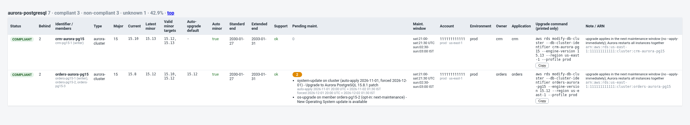
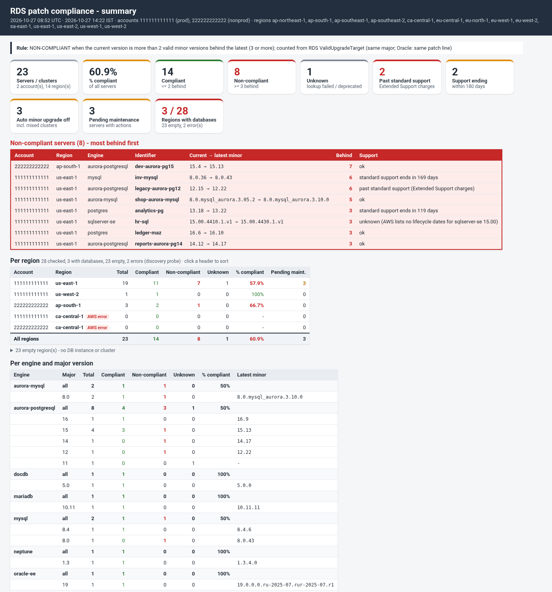

# rds_patch_compliance_report.sh

A **read-only** patch compliance report for AWS databases. For every Aurora cluster, RDS instance, Multi-AZ DB cluster, DocumentDB cluster and Neptune cluster it shows how many **minor versions** the database is behind, and marks it **COMPLIANT** or **NON-COMPLIANT**. Versions behind are the **valid minor upgrade targets RDS returns for the current version** (v1.1.0). It also flags majors past (or near) the end of standard support (Extended Support charges), auto minor upgrade switched off, pending maintenance and deprecated versions. It works across several accounts (profiles) and regions. Output formats are text, CSV, JSON and a single-file HTML report.

```
./rds_patch_compliance_report.sh -P prod,nonprod -r us-east-1,ap-south-1 -F csv,html,txt -o ~/compliance
```

* **Engines and what is judged:**
  * Aurora clusters: `aurora-postgresql`, `aurora-mysql`. Judged **per cluster**; members are listed.
  * Multi-AZ DB clusters (RDS PostgreSQL / MySQL with readable standbys): per cluster.
  * DocumentDB and Neptune clusters: per cluster.
  * Standalone RDS instances: `postgres`, `mysql`, `mariadb`, `sqlserver-ee/se/ex/web`, `oracle-ee/se2/ee-cdb/se2-cdb`. Judged **per instance** (read replicas are their own rows).
  * Instances that belong to a cluster are not separate rows. Other engines (e.g. RDS Custom, Db2) are ignored.
* **Strictly read-only.** Calls: `sts get-caller-identity`, `ec2 describe-regions` (only for `--all-regions`), the `--all-regions` discovery probe (`rds describe-db-instances` / `describe-db-clusters --max-records 20 --query length(...) --no-paginate`), `rds describe-db-clusters`, `rds describe-db-instances`, `rds describe-pending-maintenance-actions`, `rds|docdb|neptune describe-db-engine-versions --engine E --engine-version V` and `rds describe-db-major-engine-versions`. The `upgrade_command` column is **printed only**, never run.
* **Requirements:** Bash 4.4+, AWS CLI v2 (2.15+ recommended, for `describe-db-major-engine-versions`), jq 1.6+. Keep `lib/compliance.jq` next to the script. curl and mail/mailx/sendmail only for the optional alerts.
* **Siblings:** [RDS_Pending_Maintenance](../RDS_Pending_Maintenance/README.md) shows *what maintenance is pending and when*; [RDS_Patch_Runner](../RDS_Patch_Runner/README.md) *applies* it to one cluster safely. This tool answers *how far behind are we on minor versions*.




## Summary script (managers / teams)

`rds_patch_compliance_summary.sh` is a separate, read-only script that shows **only the high-level picture and the NON-COMPLIANT servers**. It runs the full report (`rds_patch_compliance_report.sh -F json`) for the scan, so the counting is identical: valid RDS minor upgrade targets only, same major line, Oracle same patch line, deprecated versions as UNKNOWN (`lib/compliance.jq` + `lib/versions.jq`); `lib/summary.jq` only renders.

```bash
./rds_patch_compliance_summary.sh -P prod,nonprod -r us-east-1,ap-south-1              # txt to the screen
./rds_patch_compliance_summary.sh -P prod --all-regions -F txt,html,csv -o ~/compliance  # files (+ txt on screen)
```

Options: `-P` (repeatable), `-r` / `--all-regions` (with `--no-discover`, `--probe-parallel N`, see [Regions](#regions-discovery-and-region-wise-breakdown-v120)), `-e`, `-i`, `--max-behind N` (default 2: NON-COMPLIANT when versions_behind > 2, i.e. 3 or more), `--warn-days`, `--oracle-any-patch-line`, `-F txt,html,csv` (default txt to the screen; html / csv / several formats need `-o`), `--prefix`, `--fail-on-noncompliant` (exit 5), `--alert-email`, `--alert-webhook`, `--alert-webhook-format slack|json`, `--alert-on noncompliant|always`, `--alert-from`, `-v`.

Output: header (run time UTC + IST, accounts / regions, the `Regions  : N checked, M with databases, K empty, E errors` line and the empty regions, the rule), overall totals and % compliant, a **per-region** table (regions with databases or an AWS error, plus an All-regions row), per engine the major-version breakdown with compliant / non-compliant / unknown and % plus the latest minor per major (Oracle per patch line), key flags as counts (past standard support, support ending within N days, auto minor upgrade off, pending maintenance), then the **NON-COMPLIANT servers** (`!!` lines in txt, red table in HTML; account, region, engine, identifier, current -> latest minor, behind, support flag; most behind first, then name) or `*** All servers compliant ***`, and the UNKNOWN servers with the reason. Compliant servers are not listed. CSV: `<prefix>_<UTC stamp>_noncompliant.csv` (non-compliant rows only) + `<prefix>_<UTC stamp>_summary.csv` (overall, engine, major and flag rows) + `<prefix>_<UTC stamp>_regions.csv` (one row per account + region, empty regions as 0 rows, plus `ALL`). Exit codes: 0, 1 usage, 2 pre-check / scan failed, 4 output, 5 non-compliant with `--fail-on-noncompliant`.

Samples: [txt](samples/sample_summary.txt), [html](samples/sample_summary.html), [regions csv](samples/sample_summary_regions.csv). Tests: `tests/run_summary_tests.sh` (mock AWS; boundaries 2/3, `--max-behind`, all-compliant, unknown, Oracle, multi-profile, numbers equal to the full report, alerts, shellcheck); `tests/validate_cli.sh` also runs it through the real AWS CLI against the local fake endpoint.



## Regions: discovery and region-wise breakdown (v1.2.0)

**Discovery (`-A` / `--all-regions`).** Most accounts have databases in a few of their ~17 enabled regions. Instead of the full scan (clusters, instances, pending maintenance, version lookups) everywhere, each enabled region is first **probed** with two read-only one-page calls:

```
aws rds describe-db-instances --max-records 20 --query 'length(DBInstances)' --no-paginate --region R
aws rds describe-db-clusters  --max-records 20 --query 'length(DBClusters)'  --no-paginate --region R
```

* Probes run in parallel, `--probe-parallel N` at a time (default 8, 1-32; config `probe_parallel`). Each probe is one request (no pagination), so a region with 500 instances costs the same as an empty one; the probe count is capped at 20.
* Only regions where a probe found a DB instance or cluster are scanned in full. A cluster-only region (e.g. a headless Aurora global secondary) counts as having databases.
* **A probe that fails (AccessDenied, SCP deny, throttling, timeout) is an error, never "empty":** it is listed under ERRORS and the region is still scanned in full, so nothing is silently skipped.
* `--no-discover` (config `discover = no`) scans every enabled region in full, as before v1.2.0. Regions given with `-r` (or the profile default) are always scanned directly, with no probe.
* `--dry-run` shows the probe commands and the full-scan commands; probes are counted in `aws_calls` (JSON `meta`, log `Result:` line).

**Header.** Text, HTML and the summary show one line plus the empty regions (a collapsible list in HTML):

```
Accounts : 111111111111 (prod)   Regions: ca-central-1, us-east-1, us-west-2 (of 14 enabled)
Regions  : 14 checked, 2 with databases, 11 empty, 1 error (discovery probe, 8 in parallel; full scan only where databases or a probe error)
Empty    : 111111111111: ap-northeast-1, ap-northeast-2, ap-south-1, ap-southeast-1, ap-southeast-2, eu-central-1, eu-north-1, eu-west-1, eu-west-2, eu-west-3, sa-east-1
```

**Region-wise breakdown.** One row per account + region (status `databases` / `error` / `empty`, total, compliant, non-compliant, unknown, % compliant, servers with pending maintenance, past standard support), then an **All regions** row. Order: regions with databases, then errors, then empty (0 rows); within that most servers first. Everywhere:

* text: `PER REGION` section after `PER ENGINE / MAJOR VERSION`; summary txt: `PER REGION` table (regions with databases or errors; empties on one line).
* HTML: a sortable, colour-coded table (% compliant bar: green >= 90 %, amber >= 70 %, red below), section `#regions`, linked from the header; a "Regions" summary card.
* CSV: an extra file `<prefix>_<stamp>_regions.csv` (`account_id, profile, region, status, total, compliant, non_compliant, unknown, pct_compliant, servers_with_pending_maintenance, pending_actions, past_standard_support, aws_errors, probe_instances_max20, probe_clusters_max20`).
* JSON: `summary.regions[]`, `summary.regions_total`, `summary.region_overview` (`mode`, `probe_parallel`, `checked`, `with_databases`, `empty`, `error`, `empty_regions`); `meta.region_status`, `meta.region_discovery`.

```
PER REGION (account x region; pending = servers with pending maintenance)
  ACCOUNT       REGION          STATUS      TOTAL  COMPL  NON-C  UNKN  %COMPL  PEND  PAST-STD
  111111111111  us-east-1       databases      19     11      7     1   57.9%     3         2
  111111111111  us-west-2       databases       1      1      0     0    100%     0         0
  111111111111  ca-central-1    error           0      0      0     0       -     0         0  see ERRORS (no data)
  111111111111  ap-northeast-1  empty           0      0      0     0       -     0         0
  ...
  ALL           All regions                    20     12      7     1     60%     3         2
```

## The compliance rule

For **each server** the report asks RDS which upgrades are valid **from its current version**:

```
aws rds describe-db-engine-versions --engine <engine> --engine-version <current> --region <region>
```

(`aws docdb ...` / `aws neptune ...` for those engines; they support the same call and return the same `ValidUpgradeTarget` list.) Only that version's `ValidUpgradeTarget[]` entries with **`IsMajorVersionUpgrade == false`** and the same `Engine` are used:

* `newer_versions` = those targets, sorted; `latest_minor_version` = the highest; **`versions_behind` = their count**.
* `default_auto_upgrade_target` = the target RDS marks `AutoUpgrade=true` (the version auto minor upgrade would move to), if any.
* Major targets are never counted or suggested (`major_upgrade_targets` in JSON only shows how many exist).
* Nothing is derived from the full engine version list any more (v1.1.0). Lookups are cached per engine + version + region.

| versions_behind | status |
|---|---|
| 0, 1 or 2 (`<= --max-behind`, default 2) | **COMPLIANT** |
| 3 or more | **NON-COMPLIANT** |
| lookup failed, or the current version is **not returned** by `describe-db-engine-versions` | **UNKNOWN** |

Not returned = deprecated or not offered in that region: `deprecated_version=true`, no targets, note `current version not returned by describe-db-engine-versions`. There is no fallback to another method.

**Worked example** (Aurora PostgreSQL 15.8; the engine offers `15.4 ... 15.8 15.10 15.12 15.13`, but RDS returns as valid targets from 15.8 only `15.10`, `15.12` (minor, AutoUpgrade on 15.12) and `16.4`, `16.8` (major)):

| | v1.0.0 (full engine list) | v1.1.0 (ValidUpgradeTarget of 15.8) |
|---|---|---|
| newer_versions | 15.10, 15.12, 15.13 | 15.10, 15.12 |
| latest_minor_version | 15.13 | 15.12 (default auto-upgrade target 15.12) |
| versions_behind | 3 → NON-COMPLIANT | **2 → COMPLIANT** |
| upgrade_command | `--engine-version 15.13` | `--engine-version 15.12` |

Boundary: 2 valid minor targets = COMPLIANT, 3 = NON-COMPLIANT (e.g. 14.12 with targets 14.13, 14.15, 14.17).

**Latest minor per major** (summary) = the highest valid minor target seen among that major's servers, or the current version when a server is up to date.

### Why v1.0.0 (full engine list) could differ from RDS's own upgrade metadata

* **Not a valid target from this version:** a release can be listed for the engine but not be an allowed upgrade *from* your version (upgrade paths are per source version; some need an intermediate hop, some newer patch levels are not yet enabled from older ones).
* **Status / lifecycle:** the full list contains versions with other statuses or limited availability (preview, deprecated-but-still-listed, versions only for new creates, Babelfish / limitless / serverless-only builds) that are not upgrade targets.
* **Regional availability:** a version can exist in AWS's catalogue but not (yet) be a target in your region; the per-version call is made in the server's region.
* **Release numbering:** "versions behind" by number gaps vs real releases (15.9 / 15.11 never shipped on Aurora) and odd naming such as Aurora MySQL `8.0.mysql_aurora.3.05.2` (Aurora release, not the MySQL patch level), SQL Server `15.00.4410.1.v1`, Oracle RU strings; deriving the major line from such strings can group wrongly.
* **Deprecated current version:** v1.0.0 still counted newer versions for a version AWS no longer returns; v1.1.0 shows UNKNOWN instead.
* **Major targets:** a target list can contain major upgrades (e.g. 15.8 → 16.x); only `IsMajorVersionUpgrade=false` entries are counted.

## Oracle versions (patch lines)

RDS for Oracle version strings look like `<major>.0.0.0.ru-<YYYY-MM>[.<line>-<YYYY-MM or N>].r<N>`:

| Example | Patch line |
|---|---|
| `19.0.0.0.ru-2026-04.r1` | plain RU (Release Update only) |
| `19.0.0.0.ru-2026-01.rur-2026-04.r1` | `rur` - Release Update Revision |
| `19.0.0.0.ru-2026-07.mrp-2026-07.r1` | `mrp` - Monthly Recommended Patches on top of the RU |
| `19.0.0.0.ru-2026-07.spb-2026-07.r1` | `spb` - Spatial Patch Bundle |

**Rule (default):** an Oracle upgrade target counts only when it has the **same major** (19 -> 19) **and the same patch line** as the current version (mrp -> mrp, rur -> rur, plain RU -> plain RU, spb -> spb). That matches what the RDS console Modify page offers. Within one line, versions are ordered numerically by RU date, then line date / number, then revision (`r2 > r1`, `r10 > r9`); a newer RU on the same line (for example `ru-2026-10.mrp-2026-10.r1` after `ru-2026-07.mrp-2026-07.r10`) counts. The current version and older builds are never counted. Targets on another line are left out and listed in the note, for example `excluded 19.0.0.0.ru-2026-07.spb-2026-07.r1 (different patch line spb; current is mrp)`.

Example (a real case): current `19.0.0.0.ru-2026-07.mrp-2026-07.r1`, RDS lists `...spb-2026-07.r1` and `...mrp-2026-07.r2`. Before 1.1.1 the report picked `spb` as "latest" (letters compared as text, spb > mrp). Now: latest minor `19.0.0.0.ru-2026-07.mrp-2026-07.r2`, 1 behind, COMPLIANT, spb excluded with a note.

In the summary table the Oracle "latest minor" is shown per patch line. Sample: [samples/oracle_patch_lines.txt](samples/oracle_patch_lines.txt) (mock scenario `oracle`).

`--oracle-any-patch-line` (config `oracle_any_patch_line = yes`) restores counting across patch lines (default off). An Oracle version string in an unknown format falls back to the generic compare, and a line is written with `-v`.

**Same-major safety net (every engine):** a target counts only if it is in the current major line, even when AWS lists it with `IsMajorVersionUpgrade=false`: Oracle / SQL Server first part (19, 15 vs 16), PostgreSQL first part (two parts before 10), MySQL / MariaDB first two parts (8.0 vs 8.4), Aurora MySQL the Aurora major (2 vs 3), DocumentDB / Neptune first two parts. Excluded targets are noted (`excluded 16.00.4185.3.v1 (different major version 16; current is 15)`).

## Other flags (shown; they do not change the status)

* **End of standard support / Extended Support** from `rds describe-db-major-engine-versions` (`SupportedEngineLifecycles`: `open-source-rds-standard-support`, `open-source-rds-extended-support`). `support_flag`:
  * `past standard support (Extended Support charges)` - standard support has ended;
  * `standard support ends in <N> days` - within `--warn-days` (default 180);
  * `ok`;
  * `unknown (...)` - AWS lists no dates for that major (e.g. SQL Server, Oracle), the call failed / was denied, or the CLI is too old (logged once, the report still runs);
  * `n/a (no lifecycle API for docdb|neptune)`.
* **Auto minor upgrade:** `true`, `false`, or `mixed` (some cluster members off). For Aurora it is read from the member instances, for Multi-AZ DB clusters from the cluster.
* **Pending maintenance** (`pending_actions_count`, `pending_actions`): maintenance actions AWS has scheduled or offered for this server that haven't been applied yet (from `describe-pending-maintenance-actions`). Cluster rows include their member instances' actions, tagged with the member name. Format per action: `<action>[ on cluster | on member <instance>] (auto-apply <UTC date>, forced <UTC date>, opt-in: <status>) - <short description>`, actions separated by `; `; `(no date, optional)` when AWS gives no date. Example: `system-update on cluster (auto-apply 2026-11-01, forced 2026-12-01) - Upgrade to Aurora PostgreSQL 15.8.1 patch; os-upgrade on member orders-pg15-2 (opt-in: next-maintenance) - New Operating System update is available`. The HTML shows a count badge (click to expand, hover for UTC and IST times); the text report lists each action under its row with the IST time; JSON has the structured `pending_actions_detail`. The summary says e.g. `pending maintenance on 3 server(s): os-upgrade 2, system-update 2, db-upgrade 1`.
* **Current version not returned / deprecated** (see above).

## Report

* **SUMMARY first** (text and HTML): totals with % compliant; per engine and major version: total / compliant / non-compliant / unknown, latest minor, support state; top N most behind (`--top`, default 10); counts of Extended Support, support ending soon, auto minor upgrade off, pending maintenance, deprecated.
* **Details:** one section per engine, sorted NON-COMPLIANT first, then UNKNOWN, COMPLIANT; within that most behind first, then name.
* **HTML:** single file, summary cards, filter box (any text), click a column header to sort, colour-coded status, **Copy** button on each upgrade command.
* `--non-compliant-only` shows only NON-COMPLIANT rows (the summary still counts everything).

### Columns (CSV; the same fields are in JSON, HTML and text)

`account_id, profile, region, resource_type, identifier, members, engine, major_version, current_version, latest_minor_version, versions_behind, newer_versions, default_auto_upgrade_target, compliance_status, auto_minor_upgrade, standard_support_end, extended_support_end, support_flag, pending_actions_count, pending_actions, deprecated_version, maint_window_utc, maint_window_ist, tag:<key>..., arn, upgrade_command, note`

* `resource_type`: `aurora-cluster`, `multi-az-cluster`, `docdb-cluster`, `neptune-cluster`, `instance`.
* `members`: cluster member instances, writer marked, e.g. `orders-pg15-1 (writer), orders-pg15-2`.
* `newer_versions`: the valid minor upgrade targets counted, space-separated in CSV. `default_auto_upgrade_target`: the `AutoUpgrade=true` target.
* `pending_actions_count` / `pending_actions`: see "Pending maintenance" above.
* `maint_window_ist`: the preferred maintenance window converted to IST (UTC+5:30), e.g. `sat:21:00-sat:21:30` → `sun:02:30-sun:03:00`.
* Tag columns: `-T Environment,Owner,Application` (default); `-T ''` for none.
* `upgrade_command` (only when behind > 0): `aws rds modify-db-cluster --db-cluster-identifier X --engine-version <latest minor> --region R [--profile P]` for clusters (`aws docdb` / `aws neptune` for those engines), `modify-db-instance --db-instance-identifier` for instances. **No `--apply-immediately`**, so the upgrade waits for the next maintenance window. Review it before running it yourself; an Aurora minor upgrade restarts all instances of the cluster together.

### Output files

With `-o DIR` each format is written to `DIR/<prefix>_<YYYYmmdd_HHMMSS>.<csv|html|txt|json>` (box local time, mode 0640); `csv` also writes `<prefix>_<YYYYmmdd_HHMMSS>_regions.csv` (region breakdown). The log prints each absolute path. Without `-o` a single format goes to stdout. Samples: [samples/](samples/) (`sample_report.txt`, `.csv`, `_regions.csv`, `.html`, `.json`, made with the test mock: `MOCK_SCENARIO=discover`, `-P prod,nonprod -A`).

**Downloading from CloudShell:** copy the full path from the `Wrote ...` log line, then **Actions > Download file** and paste it, e.g. `/home/cloudshell-user/compliance/rds_patch_compliance_20261015_093000.html`. For several files: `cd ~ && zip -r compliance.zip compliance` and download `/home/cloudshell-user/compliance.zip`.

## Usage

```
# get the tools in CloudShell (once)
git clone https://github.com/manideepgrandhi/DBA.git ~/DBA && cd ~/DBA/AWS/RDS_Patch_Compliance

./rds_patch_compliance_report.sh                                 # current region, text to the screen
./rds_patch_compliance_report.sh -r us-east-1,ap-south-1 -F html -o ~/compliance
./rds_patch_compliance_report.sh -P prod,nonprod --all-regions -F csv,html,txt,json -o ~/compliance
./rds_patch_compliance_report.sh -e 'aurora-*' -i 'prod-*' --non-compliant-only
./rds_patch_compliance_report.sh --max-behind 1 --warn-days 365 --fail-on-noncompliant   # exit 5 if any NON-COMPLIANT
./rds_patch_compliance_report.sh --config rds_patch_compliance_report.conf.example --dry-run
```

More in [EXAMPLES.md](EXAMPLES.md). `--help` lists every option.

| Option | Meaning |
|---|---|
| `-P, --profile` | profile(s) / accounts; repeatable or comma-separated |
| `-r, --region` / `-A, --all-regions` | regions (default: the profile's region; no probe) / every enabled region, probed first |
| `--no-discover` / `--probe-parallel N` | with `-A`: scan every region in full / probes at a time (default 8, 1-32) |
| `-e, --engine GLOB` / `-i, --identifier GLOB` | filters (case-insensitive globs; a cluster also matches by member name) |
| `--max-behind N` | threshold, default 2 |
| `--warn-days N` | "support ends soon" window, default 180 |
| `--non-compliant-only` | only NON-COMPLIANT rows |
| `--fail-on-noncompliant` | exit 5 when any NON-COMPLIANT |
| `-T, --tag-columns` | tag keys as columns |
| `-F, --format` / `-o, --output-dir` / `--prefix` | `text,csv,json,html` (`txt` = text) / folder / file prefix |
| `--top N` | size of the most-behind list, default 10 |
| `-l, --log-file` | append timestamped log lines |
| `--alert-email`, `--alert-webhook`, `--alert-webhook-format slack|json`, `--alert-on noncompliant|always`, `--alert-test` | optional alerts (Slack text truncated at 35 000 chars) |
| `--config FILE` | key=value file, **parsed, never sourced**; CLI options override it; credentials are refused |
| `--aws-timeout`, `--max-attempts`, `--keep-workdir`, `--dry-run`, `-v` | behaviour |

### Exit codes

`0` report produced (also when servers are non-compliant), `5` NON-COMPLIANT found with `--fail-on-noncompliant`, `1` usage, `2` pre-check (aws/jq missing, no profile usable), `4` output error, `130` interrupted. Partial AWS errors (a region denied, a failed discovery probe) are listed under ERRORS in the report; they do not change the exit code.

## IAM policy (read-only)

```json
{
  "Version": "2012-10-17",
  "Statement": [{
    "Sid": "RdsPatchComplianceReadOnly",
    "Effect": "Allow",
    "Action": [
      "rds:DescribeDBClusters",
      "rds:DescribeDBInstances",
      "rds:DescribePendingMaintenanceActions",
      "rds:DescribeDBEngineVersions",
      "rds:DescribeDBMajorEngineVersions",
      "ec2:DescribeRegions"
    ],
    "Resource": "*"
  }]
}
```

`sts:GetCallerIdentity` needs no permission. DocumentDB and Neptune use the same `rds:` actions. Without `rds:DescribeDBMajorEngineVersions` the report still works; support dates show `unknown`. The AWS managed `ReadOnlyAccess` policy also covers it.

## Configuration file

See [rds_patch_compliance_report.conf.example](rds_patch_compliance_report.conf.example). `key = value`, `#` comments, lists comma-separated. The file is parsed line by line, never sourced, unknown keys and credential keys are errors.

## Tests

No AWS account is used and nothing can reach AWS.

* `tests/run_tests.sh` - 340+ checks against `tests/mock/aws` (realistic fleet: Aurora PostgreSQL 11/12/14/15/16 incl. Extended Support, Aurora MySQL 3, RDS PostgreSQL 13/16/17, MySQL 8.0/8.4, MariaDB, SQL Server, Oracle, Multi-AZ DB cluster, DocumentDB, Neptune). Covers counting only from ValidUpgradeTarget (the mock's full list differs on purpose), major targets excluded, the default auto-upgrade target, current version not returned, pending-actions text, version compare units (`15.10 > 15.9`, Aurora MySQL, SQL Server, Oracle), the 2/3 boundary, `--max-behind`, lookup failure (UNKNOWN), deprecated version, lifecycle API missing / denied, multi-profile / multi-region, all regions, filters, outputs, alerts (local stubs), region discovery (empty regions skipped, cluster-only region, probe AccessDenied scanned anyway, `--no-discover`, `-r` without probe, parallel probes faster than serial with the same result, dry-run, `aws_calls`), the region breakdown adding up to the totals in every format, a 3000-instance fleet (no ARG_MAX issues) and that no file is written into the tool folder. **Guard:** it refuses to run unless `aws` on PATH is the mock, and sets fake credentials and a dead endpoint.
* `tests/validate_cli.sh` - replays every command line the script issues, and every printed `upgrade_command`, through the **real** AWS CLI v2 with fake credentials and a dead endpoint (`127.0.0.1:9`); checks mock output shapes against `--generate-cli-skeleton output`; and runs the script with the real CLI against a local fake endpoint that pages every list (Marker) to prove pagination, and `-A` against a region-aware fake endpoint to prove each discovery probe is a single request, a denied probe becomes an error region that is still scanned, and only regions with databases get a full scan. A wrapper refuses any real-CLI call without a loopback endpoint.

## Changelog

* **1.2.0 / summary 1.1.0** - `--all-regions` discovery: per region two parallel one-page probes (`--max-records 20 --query length(...) --no-paginate`, `--probe-parallel`, default 8); full scan only where databases are found; a failed probe is an error and the region is still scanned; `--no-discover` / `discover = no`; `-r` regions are never probed; probes in `--dry-run` and `aws_calls`. Header `Regions  : N checked, M with databases, K empty, E errors` + empty-region list. Region-wise breakdown (account x region + All regions) in text, HTML (sortable, colour-coded), JSON, `*_regions.csv` and the summary script (txt / html / `*_regions.csv`).
* **summary 1.0.0** - New `rds_patch_compliance_summary.sh` (+ `lib/summary.jq`, `tests/run_summary_tests.sh`): high-level summary and the NON-COMPLIANT servers only; reuses the full report for the scan and all counting.
* **1.1.1** - Oracle: upgrade targets count only on the SAME patch line as the current version (mrp/rur/plain RU/spb; numeric ru date, line date, rN ordering); other lines are excluded with a note. Fixes `...mrp-2026-07.r1` showing `...spb-2026-07.r1` as latest (console offers `...mrp-2026-07.r2`). Same-major safety net for every engine (a target AWS marks as minor but in another major line is excluded and noted). New `--oracle-any-patch-line` / `oracle_any_patch_line`. JSON rows gain `excluded_targets`, `version_warnings`; meta gains `oracle_any_patch_line`. Shared logic in `lib/versions.jq` (same file in RDS_Pending_Maintenance and RDS_Patch_Runner). Mock scenario `oracle`.
* **1.1.0** - Counting source is now RDS metadata only: per server `describe-db-engine-versions --engine E --engine-version <current>`, `ValidUpgradeTarget[]` with `IsMajorVersionUpgrade=false` (no more full-list counting or own derivation); new column `default_auto_upgrade_target`; current version not returned → UNKNOWN + deprecated note; cache per engine+version+region; summary latest minor = highest valid target seen. Pending maintenance is now `pending_actions_count` + readable `pending_actions` (action, on cluster / member, auto-apply / forced dates, opt-in status, short description), HTML badge with expandable list and IST tooltip, summary by action type, legend.
* **1.0.0** - First version.

## Caveats

* Valid targets are per region; the report asks in the server's own region.
* `latest_minor_version` is the highest valid minor target from the current version, which is what the printed command targets. A newer minor that exists for the engine but is not a valid target yet will appear once RDS allows it (or after an intermediate upgrade).
* Aurora MySQL 2 (`5.7.mysql_aurora.2.x`) and 3 (`8.0.mysql_aurora.3.x`) are different majors.
* Engines without lifecycle data (DocumentDB, Neptune, and majors AWS does not list) show `unknown` / `n/a`, never `ok`.
