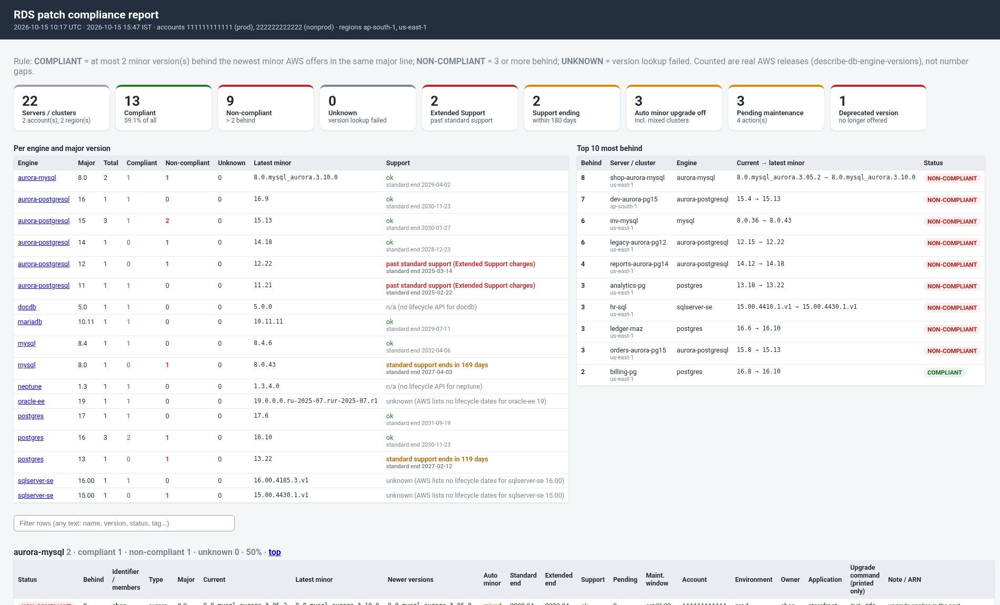

# rds_patch_compliance_report.sh

A **read-only** patch compliance report for AWS databases. For every Aurora cluster, RDS instance, Multi-AZ DB cluster, DocumentDB cluster and Neptune cluster it shows how many **minor versions** the database is behind the newest minor AWS offers in its major line, and marks it **COMPLIANT** or **NON-COMPLIANT**. It also flags majors past (or near) the end of standard support (Extended Support charges), auto minor upgrade switched off, pending maintenance and deprecated versions. It works across several accounts (profiles) and regions. Output formats are text, CSV, JSON and a single-file HTML report.

```
./rds_patch_compliance_report.sh -P prod,nonprod -r us-east-1,ap-south-1 -F csv,html,txt -o ~/compliance
```

* **Engines and what is judged:**
  * Aurora clusters: `aurora-postgresql`, `aurora-mysql`. Judged **per cluster**; members are listed.
  * Multi-AZ DB clusters (RDS PostgreSQL / MySQL with readable standbys): per cluster.
  * DocumentDB and Neptune clusters: per cluster.
  * Standalone RDS instances: `postgres`, `mysql`, `mariadb`, `sqlserver-ee/se/ex/web`, `oracle-ee/se2/ee-cdb/se2-cdb`. Judged **per instance** (read replicas are their own rows).
  * Instances that belong to a cluster are not separate rows. Other engines (e.g. RDS Custom, Db2) are ignored.
* **Strictly read-only.** Calls: `sts get-caller-identity`, `ec2 describe-regions` (only for `--all-regions`), `rds describe-db-clusters`, `rds describe-db-instances`, `rds describe-pending-maintenance-actions`, `rds|docdb|neptune describe-db-engine-versions` and `rds describe-db-major-engine-versions`. The `upgrade_command` column is **printed only**, never run.
* **Requirements:** Bash 4.4+, AWS CLI v2 (2.15+ recommended, for `describe-db-major-engine-versions`), jq 1.6+. Keep `lib/compliance.jq` next to the script. curl and mail/mailx/sendmail only for the optional alerts.
* **Siblings:** [RDS_Pending_Maintenance](../RDS_Pending_Maintenance/README.md) shows *what maintenance is pending and when*; [RDS_Patch_Runner](../RDS_Patch_Runner/README.md) *applies* it to one cluster safely. This tool answers *how far behind are we on minor versions*.



## The compliance rule

`versions_behind` = the number of minor versions **AWS actually offers** (`describe-db-engine-versions --engine <engine>`) in the **same major line** that are **newer** than the current version.

| versions_behind | status |
|---|---|
| 0, 1 or 2 (`<= --max-behind`, default 2) | **COMPLIANT** |
| 3 or more | **NON-COMPLIANT** |
| version list could not be read | **UNKNOWN** (the lookup error is in `note`) |

**Releases are counted, not number gaps.** Worked example (Aurora PostgreSQL 15, AWS offers `15.4 15.5 15.6 15.7 15.8 15.10 15.12 15.13`):

| current | newer versions AWS offers | versions_behind | status |
|---|---|---|---|
| 15.13 | - | 0 | COMPLIANT |
| 15.10 | 15.12, 15.13 | **2** | COMPLIANT (boundary) |
| 15.8 | 15.10, 15.12, 15.13 | **3** | NON-COMPLIANT (boundary) |
| 15.4 | 15.5 ... 15.13 | 7 | NON-COMPLIANT |

15.8 → 15.13 is 5 by number but only 3 real releases (15.9 and 15.11 were never released on Aurora), so it is 3 behind.

* **Major line** = AWS's `MajorEngineVersion` for the current version: `16` for PostgreSQL 16.x, `8.0` for MySQL 8.0 and Aurora MySQL 3 (`8.0.mysql_aurora.3.x`), `15.00` for SQL Server 2019, `19` for Oracle 19c. DocumentDB / Neptune have no such field, so the first two numbers are used (`5.0`, `1.3`). Major upgrades are never counted or suggested.
* **Version compare** (per engine, one rule): the version string is split into runs of digits and letters; digits compare as numbers. So `15.10 > 15.9`, `8.0.mysql_aurora.3.10.0 > 8.0.mysql_aurora.3.9.0` (`3.05.2` = `3.5.2`), `15.00.4430.1.v1 > 15.00.4415.2.v1`, `19.0.0.0.ru-2025-07.rur-2025-07.r1 > 19.0.0.0.ru-2025-04...`.
* **Deprecated version:** if the current version is no longer in AWS's list, it is flagged `deprecated_version=true` (it can no longer be used for new servers); behind is still counted against the versions offered.
* Lookups are cached: one `describe-db-engine-versions` and one `describe-db-major-engine-versions` call per engine and region (shared by all profiles). The CLI follows every page.
* Change the threshold with `--max-behind N`.

## Other flags (shown; they do not change the status)

* **End of standard support / Extended Support** from `rds describe-db-major-engine-versions` (`SupportedEngineLifecycles`: `open-source-rds-standard-support`, `open-source-rds-extended-support`). `support_flag`:
  * `past standard support (Extended Support charges)` - standard support has ended;
  * `standard support ends in <N> days` - within `--warn-days` (default 180);
  * `ok`;
  * `unknown (...)` - AWS lists no dates for that major (e.g. SQL Server, Oracle), the call failed / was denied, or the CLI is too old (logged once, the report still runs);
  * `n/a (no lifecycle API for docdb|neptune)`.
* **Auto minor upgrade:** `true`, `false`, or `mixed` (some cluster members off). For Aurora it is read from the member instances, for Multi-AZ DB clusters from the cluster.
* **Pending maintenance:** number of pending actions on the cluster, its members, or the instance.
* **Deprecated current version** (see above).

## Report

* **SUMMARY first** (text and HTML): totals with % compliant; per engine and major version: total / compliant / non-compliant / unknown, latest minor, support state; top N most behind (`--top`, default 10); counts of Extended Support, support ending soon, auto minor upgrade off, pending maintenance, deprecated.
* **Details:** one section per engine, sorted NON-COMPLIANT first, then UNKNOWN, COMPLIANT; within that most behind first, then name.
* **HTML:** single file, summary cards, filter box (any text), click a column header to sort, colour-coded status, **Copy** button on each upgrade command.
* `--non-compliant-only` shows only NON-COMPLIANT rows (the summary still counts everything).

### Columns (CSV; the same fields are in JSON, HTML and text)

`account_id, profile, region, resource_type, identifier, members, engine, major_version, current_version, latest_minor_version, versions_behind, newer_versions, compliance_status, auto_minor_upgrade, standard_support_end, extended_support_end, support_flag, pending_actions, deprecated_version, maint_window_utc, maint_window_ist, tag:<key>..., arn, upgrade_command, note`

* `resource_type`: `aurora-cluster`, `multi-az-cluster`, `docdb-cluster`, `neptune-cluster`, `instance`.
* `members`: cluster member instances, writer marked, e.g. `orders-pg15-1 (writer), orders-pg15-2`.
* `newer_versions`: the releases counted, space-separated in CSV.
* `maint_window_ist`: the preferred maintenance window converted to IST (UTC+5:30), e.g. `sat:21:00-sat:21:30` → `sun:02:30-sun:03:00`.
* Tag columns: `-T Environment,Owner,Application` (default); `-T ''` for none.
* `upgrade_command` (only when behind > 0): `aws rds modify-db-cluster --db-cluster-identifier X --engine-version <latest minor> --region R [--profile P]` for clusters (`aws docdb` / `aws neptune` for those engines), `modify-db-instance --db-instance-identifier` for instances. **No `--apply-immediately`**, so the upgrade waits for the next maintenance window. Review it before running it yourself; an Aurora minor upgrade restarts all instances of the cluster together.

### Output files

With `-o DIR` each format is written to `DIR/<prefix>_<YYYYmmdd_HHMMSS>.<csv|html|txt|json>` (box local time, mode 0640); the log prints each absolute path. Without `-o` a single format goes to stdout. Samples: [samples/](samples/) (`sample_report.txt`, `.csv`, `.html`, `.json`, made with the test mock).

**Downloading from CloudShell:** copy the full path from the `Wrote ...` log line, then **Actions > Download file** and paste it, e.g. `/home/cloudshell-user/compliance/rds_patch_compliance_20261015_093000.html`. For several files: `cd ~ && zip -r compliance.zip compliance` and download `/home/cloudshell-user/compliance.zip`.

## Usage

```
# get the tools in CloudShell (once)
git clone https://github.com/manideepgrandhi/DBA.git ~/DBA && cd ~/DBA/AWS/RDS_Patch_Compliance

./rds_patch_compliance_report.sh                                 # current region, text to the screen
./rds_patch_compliance_report.sh -r us-east-1,ap-south-1 -F html -o ~/compliance
./rds_patch_compliance_report.sh -P prod,nonprod --all-regions -F csv,html,txt,json -o ~/compliance
./rds_patch_compliance_report.sh -e 'aurora-*' -i 'prod-*' --non-compliant-only
./rds_patch_compliance_report.sh --max-behind 1 --warn-days 365 --fail-on-noncompliant   # exit 5 if any NON-COMPLIANT
./rds_patch_compliance_report.sh --config rds_patch_compliance_report.conf.example --dry-run
```

More in [EXAMPLES.md](EXAMPLES.md). `--help` lists every option.

| Option | Meaning |
|---|---|
| `-P, --profile` | profile(s) / accounts; repeatable or comma-separated |
| `-r, --region` / `-A, --all-regions` | regions (default: the profile's region) / every enabled region |
| `-e, --engine GLOB` / `-i, --identifier GLOB` | filters (case-insensitive globs; a cluster also matches by member name) |
| `--max-behind N` | threshold, default 2 |
| `--warn-days N` | "support ends soon" window, default 180 |
| `--non-compliant-only` | only NON-COMPLIANT rows |
| `--fail-on-noncompliant` | exit 5 when any NON-COMPLIANT |
| `-T, --tag-columns` | tag keys as columns |
| `-F, --format` / `-o, --output-dir` / `--prefix` | `text,csv,json,html` (`txt` = text) / folder / file prefix |
| `--top N` | size of the most-behind list, default 10 |
| `-l, --log-file` | append timestamped log lines |
| `--alert-email`, `--alert-webhook`, `--alert-webhook-format slack|json`, `--alert-on noncompliant|always`, `--alert-test` | optional alerts (Slack text truncated at 35 000 chars) |
| `--config FILE` | key=value file, **parsed, never sourced**; CLI options override it; credentials are refused |
| `--aws-timeout`, `--max-attempts`, `--keep-workdir`, `--dry-run`, `-v` | behaviour |

### Exit codes

`0` report produced (also when servers are non-compliant), `5` NON-COMPLIANT found with `--fail-on-noncompliant`, `1` usage, `2` pre-check (aws/jq missing, no profile usable), `4` output error, `130` interrupted. Partial AWS errors (a region denied) are listed under ERRORS in the report; they do not change the exit code.

## IAM policy (read-only)

```json
{
  "Version": "2012-10-17",
  "Statement": [{
    "Sid": "RdsPatchComplianceReadOnly",
    "Effect": "Allow",
    "Action": [
      "rds:DescribeDBClusters",
      "rds:DescribeDBInstances",
      "rds:DescribePendingMaintenanceActions",
      "rds:DescribeDBEngineVersions",
      "rds:DescribeDBMajorEngineVersions",
      "ec2:DescribeRegions"
    ],
    "Resource": "*"
  }]
}
```

`sts:GetCallerIdentity` needs no permission. DocumentDB and Neptune use the same `rds:` actions. Without `rds:DescribeDBMajorEngineVersions` the report still works; support dates show `unknown`. The AWS managed `ReadOnlyAccess` policy also covers it.

## Configuration file

See [rds_patch_compliance_report.conf.example](rds_patch_compliance_report.conf.example). `key = value`, `#` comments, lists comma-separated. The file is parsed line by line, never sourced, unknown keys and credential keys are errors.

## Tests

No AWS account is used and nothing can reach AWS.

* `tests/run_tests.sh` - 200+ checks against `tests/mock/aws` (realistic fleet: Aurora PostgreSQL 11/12/14/15/16 incl. Extended Support, Aurora MySQL 3, RDS PostgreSQL 13/16/17, MySQL 8.0/8.4, MariaDB, SQL Server, Oracle, Multi-AZ DB cluster, DocumentDB, Neptune). Covers version compare units (`15.10 > 15.9`, Aurora MySQL, SQL Server, Oracle), the 2/3 boundary, `--max-behind`, lookup failure (UNKNOWN), deprecated version, lifecycle API missing / denied, multi-profile / multi-region, all regions, filters, outputs, alerts (local stubs), a 3000-instance fleet (no ARG_MAX issues) and that no file is written into the tool folder. **Guard:** it refuses to run unless `aws` on PATH is the mock, and sets fake credentials and a dead endpoint.
* `tests/validate_cli.sh` - replays every command line the script issues, and every printed `upgrade_command`, through the **real** AWS CLI v2 with fake credentials and a dead endpoint (`127.0.0.1:9`); checks mock output shapes against `--generate-cli-skeleton output`; and runs the script with the real CLI against a local fake endpoint that pages every list (Marker) to prove pagination. A wrapper refuses any real-CLI call without a loopback endpoint.

## Caveats

* AWS's version list is per region; the report compares in the server's own region.
* `latest_minor_version` is the newest minor in the major line, which is what the printed command targets. Some old versions need an intermediate hop; if `modify` refuses, check `aws rds describe-db-engine-versions --engine <e> --engine-version <current> --query 'DBEngineVersions[].ValidUpgradeTarget[?IsMajorVersionUpgrade==\`false\`].EngineVersion'`.
* Aurora MySQL 2 (`5.7.mysql_aurora.2.x`) and 3 (`8.0.mysql_aurora.3.x`) are different majors.
* Engines without lifecycle data (DocumentDB, Neptune, and majors AWS does not list) show `unknown` / `n/a`, never `ok`.
