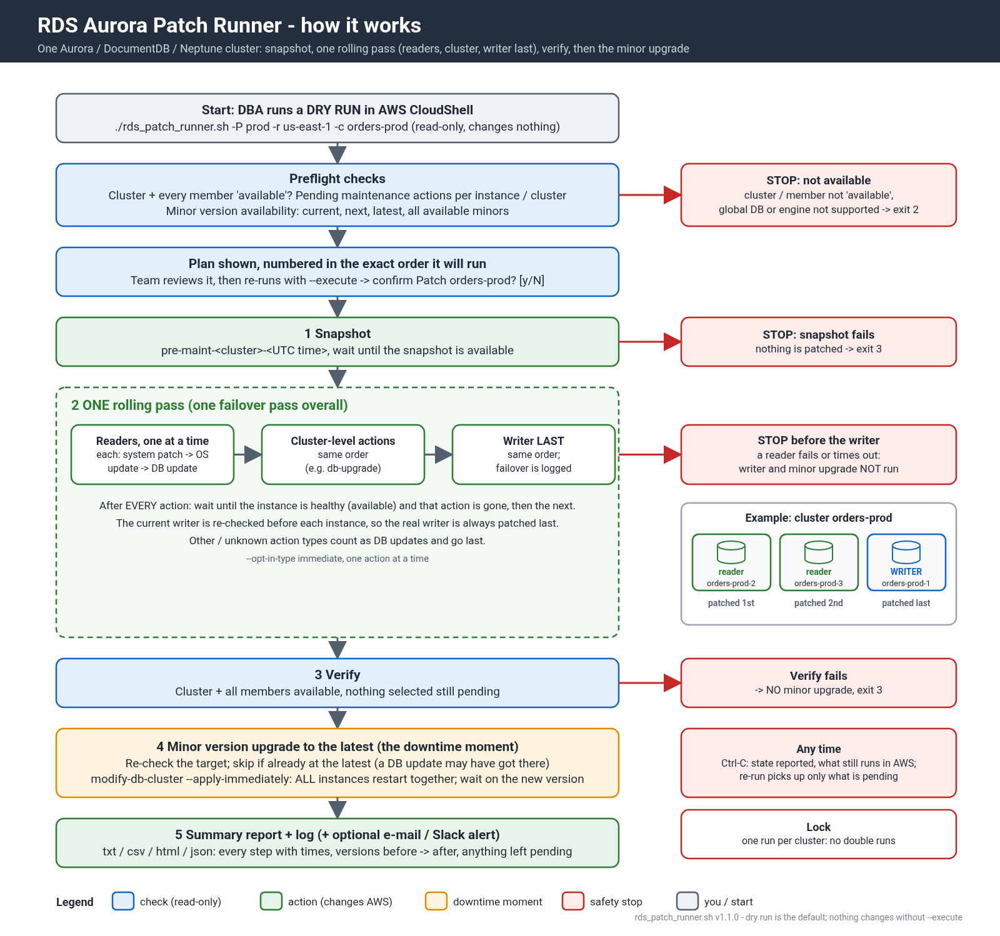
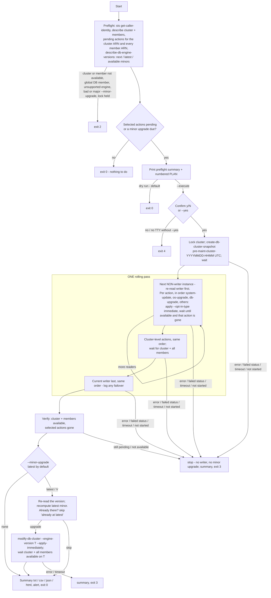
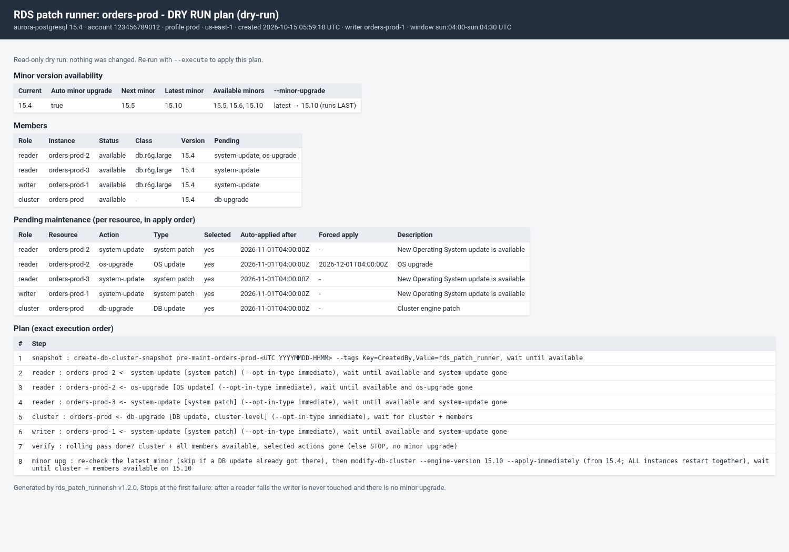

# rds_patch_runner.sh

Applies the **pending maintenance of ONE Aurora cluster** in a safe, logged order. It works with Aurora PostgreSQL and Aurora MySQL, and also with DocumentDB and Neptune clusters. It is the next step after [RDS_Pending_Maintenance](../RDS_Pending_Maintenance/README.md): the report tells you what is pending, and this tool applies it to one cluster at a time.

Sibling tool: [RDS_Patch_Compliance](../RDS_Patch_Compliance/README.md) is a read-only report of how many minor versions each database is behind (compliance rule, Extended Support / end-of-support flags) - use it to decide which clusters to patch next.

```
# 1. look first (DEFAULT: dry run, read-only)
./rds_patch_runner.sh -P prod -r us-east-1 -c orders-prod
# 2. patch
./rds_patch_runner.sh -P prod -r us-east-1 -c orders-prod --execute
```

* **Dry run is the default.** Without `--execute` the tool only makes describe calls, prints the plan and saves it to `./rds_patch_runs` (see [Output files](#output-files)). A real run needs `--execute` and then a `Patch <cluster>? [y/N]` answer, or `--yes`.
* **Order: ONE rolling pass, then the minor upgrade LAST.** preflight → confirm → cluster snapshot → **readers one at a time** (each reader gets all its actions back to back: `system-update` → `os-upgrade` → `db-upgrade` → other types) → cluster-level actions (same order) → **current writer last** (same order) → verify → **latest minor version upgrade** → summary. There is one failover pass overall, not one round per action type.
* **Stops at the first failure.** If a reader fails or times out, the writer is never touched and there is **no minor upgrade**. Any failure in the rolling pass or its verification also means no minor upgrade.
* **Requirements:** Bash 4.4+, AWS CLI v2, jq 1.6+, and `timeout` (coreutils). The tool is the main script plus `lib/runner.jq`; keep them together. It runs in AWS CloudShell as is.

## Flow



*Overview for the team ([SVG](docs/patch_runner_flow.svg); generated by `docs/gen.py`). The detailed flow is below.*




### Action order inside the rolling pass

| Rank | Action type | Group | Notes |
|---|---|---|---|
| 1 | `system-update` | system patches | applied first on each resource |
| 2 | `os-upgrade` | OS updates | |
| 3 | `db-upgrade` | DB updates | on Aurora usually a cluster-level action; it can change the engine version |
| 4 | everything else: `ca-certificate-rotation`, `hardware-maintenance`, and any **unknown/future** type | DB updates (other) | grouped with the DB updates and applied **last**, alphabetically |

On each resource the actions are applied **one at a time**: apply, wait until the resource is `available` **and that action is no longer pending**, then the next action. Before each further action the tool re-reads the pending list; an action that an earlier one already cleared is recorded as `skipped`.

### Minor version upgrade (last)

* `--minor-upgrade latest` is the **default** (your workflow); `--minor-upgrade 15.10` targets an exact minor; `--minor-upgrade none` skips it.
* It runs only after the rolling pass is **verified**. The tool then re-reads the cluster version and recomputes the target, because a `db-upgrade` may already have moved the version. If the cluster is already on the latest (or past the given version) the step is recorded as `skipped: already at latest`.
* Then `modify-db-cluster --engine-version <target> --apply-immediately`, and the tool waits until the cluster and **every member** are `available` and on the target version.
* Only non-major `ValidUpgradeTarget`s from `describe-db-engine-versions` are used; **major upgrades are always refused** (exit 2 at preflight).
* **Downtime:** an Aurora minor version upgrade restarts **all instances together** (writer and readers at the same time; it is not rolling), so it is the main downtime moment of the run, typically a few minutes. That is why it is a separate, last step. On engine versions that support **zero-downtime patching (ZDP)** (recent Aurora MySQL 2/3 and Aurora PostgreSQL minor versions), Aurora tries to keep client connections open across the engine restart; ZDP is best effort and can fall back to a normal restart, so still plan a window. DocumentDB and Neptune engine upgrades also restart the whole cluster.

## Snapshot only

`--snapshot-only` takes **just the cluster snapshot**, with no maintenance actions and no minor upgrade. Use it before risky changes, or for an ad-hoc backup with the same naming, logging and lock as a patch run.

```
./rds_patch_runner.sh -P prod -r us-east-1 -c orders-prod --snapshot-only                     # dry run: shows the plan, saves the dry-run files
./rds_patch_runner.sh -P prod -r us-east-1 -c orders-prod --snapshot-only --execute           # asks 'Snapshot orders-prod? [y/N]'
./rds_patch_runner.sh -P prod -r us-east-1 -c orders-prod --snapshot-only --execute --yes \
    --snapshot-name-prefix manual --tag Ticket=CHG-1234 --tag 'Owner=dba team' --html         # manual-orders-prod-<UTC YYYYMMDD-HHMM>
```

* **Preflight:** the cluster must exist and be `available`. Members are listed with their status but do not need to be `available`. Pending actions and minor versions are **not** looked up (no `DescribePendingMaintenanceActions` / `DescribeDBEngineVersions` calls), and "nothing to do" does not apply.
* **Global databases:** allowed. The snapshot covers the regional cluster you name, and the plan says so.
* **Execute:** `create-db-cluster-snapshot`, then the same wait as a patch run (`aws rds wait db-cluster-snapshot-available` inside the step timeout, falling back to polling). This is the only write call. The per-cluster lock is taken, so a snapshot-only run cannot overlap a patch run on the same cluster.
* **Summary:** the log, `.summary.txt` / `.csv` / `.json`, and `.summary.html` with `--html`. They show the snapshot name, ARN, status, engine and version, allocated storage (GB), create time, the tags requested, and the step's start, end and duration in UTC.
* **Name:** `<prefix>-<cluster>-<UTC YYYYMMDD-HHMM>`. `--snapshot-name-prefix` defaults to `pre-maint`. It must start with a letter and contain only letters, digits and single hyphens (max 40), for example `manual`. The prefix applies to normal patch runs too.
* **Tags:** `--tag Key=Value` (repeatable) is passed as `--tags Key=K,Value=V ...`. `CreatedBy=rds_patch_runner` is added unless you set `CreatedBy` yourself or pass `--no-default-tag`. Keys: 1-128 characters from letters, digits and `_ . : / + @ -`, and no `aws:` prefix. Values: up to 256 characters, no commas. Patch-run snapshots get the same tags.
* **Conflicts (exit 1):** `--snapshot-only` with `--skip-snapshot`, `--action`, or a `--minor-upgrade` other than the default `latest`. In a config file use `snapshot_only = yes`.
* **Exit codes:** 0 snapshot available, 1 usage, 2 preflight abort (cluster not found or not available, lock held), 3 snapshot failed or timed out, 4 declined, 130 interrupted.
* DocumentDB and Neptune work the same way (`aws docdb` / `aws neptune create-db-cluster-snapshot`).

## Steps in detail

| Step | What happens | Stops with |
|---|---|---|
| 0. Preflight | `describe-db-clusters`, `describe-db-instances --filters Name=db-cluster-id`, `describe-pending-maintenance-actions --resource-identifier` for the cluster ARN and each member ARN, and `describe-db-engine-versions` for the current version. The preflight summary shows the minor version availability (current version, auto minor upgrade, next minor, latest minor, all available minors), every member and the cluster with role, status, version and pending actions, and each pending action with type, description, auto-applied-after and forced-apply dates. Then the PLAN, numbered in the exact execution order. | exit 2 if the cluster or any member is not `available`, if the cluster is in a global database (`GlobalClusterIdentifier`), if the engine is not supported, or if the lock is held. Exit 0 if there is nothing to do. |
| 1. Confirm | `Patch <cluster> (account, region)? [y/N]`. With no terminal and no `--yes`, the run aborts. | exit 4 |
| 2. Snapshot | `create-db-cluster-snapshot` named `pre-maint-<cluster>-<YYYYMMDD-HHMM>` in UTC (sanitised the same way as in the report). Then `timeout <step timeout> aws rds wait db-cluster-snapshot-available`. The CLI waiter gives up after 30 minutes, and DocumentDB/Neptune have no waiter of their own, so the tool then falls back to polling `describe-db-cluster-snapshots`. `--skip-snapshot` skips this step (not recommended). | exit 3 |
| 3. Readers | One instance at a time. Its selected actions back to back in the order above, **one step per action**: `apply-pending-maintenance-action --opt-in-type immediate`, then poll until `available` and that action is gone (see below). | exit 3: writer untouched, no minor upgrade |
| 4. Cluster-level | Cluster-ARN actions (usually `system-update` / `db-upgrade` on the cluster), same order, **after the readers and before the writer**. The tool waits for the cluster **and all members** to be available. | exit 3, no minor upgrade |
| 5. Writer | Always the **current** writer, last, same order. See "Writer and failover" below. | exit 3, no minor upgrade |
| 6. Verify | Re-reads everything. It fails if any *selected* action type is still pending or anything is not `available`. Unselected actions are listed and do not fail the run. | exit 3, no minor upgrade |
| 7. Minor upgrade (last) | See "Minor version upgrade (last)" above. Default `latest`; `none` skips it. | exit 3 |

### Polling (instances and the cluster)

* The step is **done** when the status is `available` **and** none of the applied actions are still pending. For a minor upgrade, the engine version must also match.
* **Quick actions:** if the status was never seen leaving `available` but the action is gone, the step is `ok` with the note "quick action".
* **Not started / deferred:** if the status stays `available` while the action is still pending after `--grace-sec` (default 600), the step fails with "not started by AWS". Nothing is guessed.
* **Failed states:** `failed`, `incompatible-*`, `inaccessible-encryption-credentials`, `storage-full` and `restore-error` stop the run.
* **Timeout:** `--timeout-min` (default 60) applies **per step**. When it runs out, the step result is `timeout` and the tool exits 3.

### Writer and failover (decision)

Aurora can fail over while an instance is being patched, and the "writer" is a moving target. Before **every** instance step, the tool re-reads `IsClusterWriter`. It then patches the next pending instance that is **not** the current writer. The current writer is always the last instance patched. Every change of writer is logged as `FAILOVER: writer changed A -> B` and listed in the summary.

* *Failover during the writer step* (A → B, where B is an already-patched reader): logged. A finishes its maintenance as a reader. No extra step is needed.
* *Failover before the writer step* (A → C, where C is unpatched): A is now a reader and is patched next. C, the new writer, is patched last. The tool warns "writer is now C (planned writer was A)".
* The tool never triggers a failover itself and never fails back. If you want the writer back on its original instance, run `failover-db-cluster` yourself afterwards.

### Ctrl-C, signals and the lock

* **SIGINT / SIGTERM:** polling stops. The log records the current step, and any opt-in already accepted by AWS is reported as `STILL RUNNING IN AWS (not cancelled)`. An `immediate` opt-in cannot be withdrawn. The log also lists the instances not yet patched and the command to check the state. The summary is written with result `interrupted`, the lock is released, and the tool exits 130. Re-running is safe: the tool re-reads what is still pending.
* **Lock:** one execute run per profile + region + cluster (`$TMPDIR/rds_patch_runner_locks/<profile>_<region>_<cluster>.lock`, a mkdir lock with a pid file). A lock held by a live pid → exit 2. A stale lock (dead pid) is removed with a warning. Dry runs take no lock. The lock is per host: two different CloudShell sessions do not see each other's locks.

## Options

| Option | Meaning |
|---|---|
| `-c, --cluster ID` | Cluster identifier (required) |
| `-P, --profile` / `-r, --region` | AWS CLI profile / region (`--region` defaults to AWS_REGION or the profile's region) |
| `--dry-run` (default) / `--execute` | Plan only / really apply |
| `-y, --yes` | Do not ask for confirmation (needed without a terminal) |
| `-a, --action LIST` | `all` (default), or for example `system-update`, `db-upgrade`, `os-upgrade`, `system-update,db-upgrade`. Unselected actions stay pending and are listed |
| `--minor-upgrade latest\|V\|none` | Minor version upgrade as the LAST step (default `latest`); `none` skips it; major versions are refused |
| `--skip-snapshot` | No pre-maintenance snapshot |
| `--snapshot-only` | Only the cluster snapshot (see "Snapshot only") |
| `--snapshot-name-prefix P` | Snapshot name prefix (default `pre-maint`) |
| `--tag Key=Value`, `--no-default-tag` | Snapshot tags (repeatable); the default `CreatedBy=rds_patch_runner` is added unless turned off |
| `--timeout-min N` | Per-step timeout in minutes (default 60; decimals allowed) |
| `--poll-sec N` | Poll interval (default 30) |
| `--grace-sec N` | "Not started by AWS" grace period (default 600) |
| `-o DIR`, `--html`, `-l FILE` | Output directory for dry runs and execute runs (default `./rds_patch_runs`), extra HTML file (`_plan.html` / `.summary.html`), log file. File names use the UTC start stamp; see "Output files" |
| `--no-save` | Dry run: print only, write no files |
| `--lock-dir DIR` | Lock directory |
| `--alert-email`, `--alert-webhook`, `--alert-webhook-format slack\|json`, `--alert-on always\|failure`, `--alert-from` | Alerts at the end of execute runs |
| `--config FILE` | key=value file (see `rds_patch_runner.conf.example`). It is parsed, never sourced; CLI options win. `execute`/`yes` and credentials are refused in the file |
| `--aws-timeout`, `--max-attempts`, `-v`, `-h`, `-V` | CLI timeouts / retries, debug, help, version |

## Exit codes

| Code | Meaning |
|---|---|
| 0 | Patched and verified, nothing to do, or dry run |
| 1 | Usage / configuration error |
| 2 | Preflight abort: cluster or member not available, global database member, unsupported engine, invalid `--minor-upgrade`, lock held, AWS read error. **Nothing was changed** |
| 3 | A step failed, timed out or was not started by AWS, or verification failed. Later steps were **not** run |
| 4 | Declined at the prompt, or no terminal and no `--yes`. Nothing changed |
| 130 | Interrupted (SIGINT/SIGTERM) |

## Output files

Every run saves its output, dry runs included. The default folder is `./rds_patch_runs`, relative to where you start the script; in CloudShell that is usually `~/DBA/AWS/RDS_Patch_Runner/rds_patch_runs`. `-o DIR` changes the folder. `<stamp>` is the run start time **in UTC**, `YYYYMMDD_HHMMSS`, for example `orders-prod_20261015_041241_plan.txt`. The last log line prints the **absolute path** of every file written. Dry runs take no lock and never write to AWS.

| Mode | Files in `<output-dir>` | With `--html` |
|---|---|---|
| Dry run (default) | `<cluster>_<stamp>_dryrun.log` (the full console output: preflight + plan), `<cluster>_<stamp>_plan.txt`, `<cluster>_<stamp>_plan.json` (meta + plan) | + `<cluster>_<stamp>_plan.html` (minor version availability, members, pending actions with dates, numbered plan) |
| Dry run, nothing to do | same three files; `plan.json` has `"result": "nothing-to-do"` | + `_plan.html` |
| Dry run, preflight abort (exit 2) | `_dryrun.log` + `_plan.json` with `"result": "aborted"`, the error message and `"plan": null` (no plan was built, so no `_plan.txt`/`.html`) | no html |
| Dry run with `--no-save` | nothing (print only, the pre-1.1.1 behaviour) | - |
| Snapshot only, dry run (`--snapshot-only`) | `<cluster>_<stamp>_dryrun.log`, `_plan.txt`, `_plan.json` (`plan.snapshot_only: true`, one snapshot step) | + `_plan.html` |
| Snapshot only, execute (ok / failed / timeout) | `<cluster>_<stamp>.log`, `.summary.txt`, `.summary.csv`, `.json` with the snapshot name, ARN, size, engine version and duration (`snapshot_info`) | + `.summary.html` |
| Execute, success | `<cluster>_<stamp>.log`, `<cluster>_<stamp>.summary.txt`, `<cluster>_<stamp>.summary.csv`, `<cluster>_<stamp>.json` | + `<cluster>_<stamp>.summary.html` |
| Execute, failed (exit 3) | same files; result `failed`, the steps run so far, and what is still pending | + `.summary.html` |
| Execute, interrupted (Ctrl-C / SIGTERM, exit 130) | same files; result `interrupted`, the step that was running | + `.summary.html` |
| Execute, preflight abort / declined | `<cluster>_<stamp>.log` only | - |

`-l FILE` replaces the log file name in either mode; the other files still go to the output folder.

```
./rds_patch_runner.sh -P prod -r us-east-1 -c orders-prod                     # -> ./rds_patch_runs/orders-prod_<stamp>_dryrun.log, _plan.txt, _plan.json
./rds_patch_runner.sh -P prod -r us-east-1 -c orders-prod -o ~/patch_reports  # -> ~/patch_reports/...
./rds_patch_runner.sh -P prod -r us-east-1 -c orders-prod --html              # + ./rds_patch_runs/orders-prod_<stamp>_plan.html
./rds_patch_runner.sh -P prod -r us-east-1 -c orders-prod -l ~/orders_dry.log # log in ~/orders_dry.log, plan files in ./rds_patch_runs
./rds_patch_runner.sh -P prod -r us-east-1 -c orders-prod --no-save           # print only
```

**Downloading from CloudShell:** copy the full path from the `Saved (...)` line, then choose **Actions > Download file** and paste that path, for example `/home/cloudshell-user/DBA/AWS/RDS_Patch_Runner/rds_patch_runs/orders-prod_20261015_041241_plan.html`. To get a whole folder, zip it first and download the zip: `cd ~ && zip -r patch_runs.zip rds_patch_runs` (adjust to the folder you used, e.g. `cd ~/DBA/AWS/RDS_Patch_Runner && zip -r ~/patch_runs.zip rds_patch_runs`, then download `/home/cloudshell-user/patch_runs.zip`).



## Output (contents)

Contents of the execute files (see the table above for the names):
* `<cluster>_<UTCstamp>.log`: timestamped log including the plan.
* `.summary.txt`, `.summary.csv`, and with `--html` also `.summary.html`: the BEFORE state (minor version availability and the pending maintenance with descriptions and dates), the minor upgrade result, one row per step (one per action) with start, end, duration, result, before → after version and detail; versions before → after per resource; pending actions left; failovers seen.
* `.json`: everything above, for automation.

See [samples/](samples/): [dry-run log](samples/orders-prod_sample_dryrun.log), [plan.txt](samples/orders-prod_sample_plan.txt) / [plan.json](samples/orders-prod_sample_plan.json) / [plan.html](samples/orders-prod_sample_plan.html) ([screenshot](docs/sample_plan_html.png)), [execute log](samples/orders-prod_sample.log), [summary txt](samples/orders-prod_sample.summary.txt) / [csv](samples/orders-prod_sample.summary.csv) / [html](samples/orders-prod_sample.summary.html) ([screenshot](samples/sample_summary.png)), and a [reader-failure run](samples/orders-prod_reader_failure_sample.log) ([summary](samples/orders-prod_reader_failure_sample.summary.txt)). All of them come from the mock, not from AWS.

## IAM permissions

A dry run needs only the read actions (a `--snapshot-only` run needs only `DescribeDBClusters`, `DescribeDBInstances`, `DescribeDBClusterSnapshots`, `CreateDBClusterSnapshot` and, for the tags, `AddTagsToResource`). `--execute` also needs the write actions.

```json
{
  "Version": "2012-10-17",
  "Statement": [
    {
      "Sid": "ReadForPlanAndPolling",
      "Effect": "Allow",
      "Action": [
        "sts:GetCallerIdentity",
        "rds:DescribeDBClusters",
        "rds:DescribeDBInstances",
        "rds:DescribePendingMaintenanceActions",
        "rds:DescribeDBClusterSnapshots",
        "rds:DescribeDBEngineVersions"
      ],
      "Resource": "*"
    },
    {
      "Sid": "WriteForExecute",
      "Effect": "Allow",
      "Action": [
        "rds:ApplyPendingMaintenanceAction",
        "rds:CreateDBClusterSnapshot",
        "rds:AddTagsToResource",
        "rds:ModifyDBCluster"
      ],
      "Resource": [
        "arn:aws:rds:*:123456789012:cluster:orders-prod",
        "arn:aws:rds:*:123456789012:db:orders-prod-*",
        "arn:aws:rds:*:123456789012:cluster-snapshot:pre-maint-*"
      ]
    }
  ]
}
```

* DocumentDB and Neptune use the same `rds:` IAM actions; the tool calls them through `aws docdb` / `aws neptune`.
* `rds:ModifyDBCluster` is needed for the minor upgrade (default `--minor-upgrade latest`; not needed with `none`). `rds:DescribeDBEngineVersions` is used by every run, including dry runs. Snapshots are created with tags (`CreatedBy=rds_patch_runner` by default), which needs `rds:AddTagsToResource` on the snapshot ARN; with `--no-default-tag` and no `--tag` you can drop it.
* **Encrypted clusters:** a same-account snapshot uses the cluster's KMS key and normally needs no extra KMS permission. If your key policy is restrictive, allow `kms:DescribeKey` and `kms:CreateGrant` on that key for the role.
* Scope the write statement to the clusters you own. Snapshots count against the manual cluster snapshot quota (100 per region by default), and the tool never deletes them.

## Examples

See [EXAMPLES.md](EXAMPLES.md) for dry run, execute, a cron/no-TTY run, action filtering, minor upgrades, DocumentDB, and reading the summary.

## Limitations

* **Single cluster per run.** Run it once per cluster, or loop over clusters yourself; see EXAMPLES.md.
* **No global databases yet.** A member of an Aurora global database is refused with exit 2. Patch the secondaries first, then the primary, by hand.
* **No RDS non-Aurora instances yet** (PostgreSQL, MySQL, MariaDB, SQL Server, Oracle, Db2), and no Multi-AZ DB clusters or Aurora Serverless v1. These are refused with exit 2.
* No blue/green deployments and no major-version upgrades. `--minor-upgrade` refuses major targets.
* Actions are applied with `--opt-in-type immediate` only, one action at a time per resource. Instances are not patched in parallel.
* The tool does not stop application traffic and does not drain connections. Readers reboot during their patch and the writer step usually causes a short write outage (or a failover); plan a window.
* The lock is per host (`/tmp`), not per account.
* Clock and timing come from the host; the timeouts are per step, not for the whole run.

## Tests

```
tests/run_tests.sh     # 169 checks against the stateful mock (no AWS)
tests/validate_cli.sh  # replays every generated command through the REAL AWS CLI v2 with fake credentials
                       # and a dead endpoint/proxy, runs negative controls, and checks mock output shapes against the CLI's output skeletons
```

* The mock (`tests/mock/aws`, Python) keeps state in a JSON file. Statuses advance one "tick" per describe call: available → upgrading → rebooting → available, and a snapshot goes creating → available.
* Mock scenarios: `ok failover earlyfailover timeout readererror readerfailed notavailable membernotavailable global nothing quick deferred minor docdb neptune waitgiveup snapfail unsupported clusteronly ordered dbtolatest uptodate writerfailed newpending minorfail snaptimeout`. In `ok` the cluster `db-upgrade` moves 15.4 → 15.5 and the minor upgrade then goes to 15.10; in `dbtolatest` the `db-upgrade` reaches 15.10, so the minor step is skipped. The mock rejects an apply on a resource that is not `available`, so overlapping actions would fail the tests.
* **Guard:** the tests put the mock first in `PATH` and refuse to start unless `command -v aws` is the mock and reports `(mock)`. Credentials are fake, config files are `/dev/null`, and `HTTP(S)_PROXY` and `AWS_ENDPOINT_URL` point to the closed port 127.0.0.1:9, so even a stray real `aws` cannot reach AWS. `validate_cli.sh` calls the real CLI only through a wrapper that forces `--endpoint-url http://127.0.0.1:9`.

## Oracle versions (patch lines)

`--minor-upgrade latest` (and an explicit `--minor-upgrade <version>`) uses minor targets from `lib/versions.jq`, shared byte-for-byte with [RDS_Patch_Compliance](../RDS_Patch_Compliance/README.md#oracle-versions-patch-lines) (full explanation there). Oracle targets count only on the **same major and the same patch line** as the current version (mrp -> mrp, rur -> rur, plain RU -> plain RU, spb -> spb), ordered numerically (ru date, line date, `r10 > r9`), like the RDS console Modify page. For every engine a target in another major line is never offered, even when AWS lists it with `IsMajorVersionUpgrade=false` (SQL Server 15 vs 16, MySQL 8.0 vs 8.4, Aurora MySQL 2 vs 3, Oracle 19 vs 26). Excluded targets are shown in the preflight as `not offered`, e.g. `excluded 19.0.0.0.ru-2026-07.spb-2026-07.r1 (different patch line spb; current is mrp)`.

The runner has no "any patch line" switch: `--minor-upgrade latest` never picks, and an explicit `--minor-upgrade <version>` refuses, a cross-major or cross-line target even if AWS lists it.

## Changelog

* 1.2.1: Minor target selection uses the shared `lib/versions.jq`: same major line for every engine and, for Oracle, the same patch line; cross-major / cross-line targets are refused even when AWS lists them as minor, and shown in the preflight as `not offered`. Mock scenario `crossmajor`.
* 1.2.0: `--snapshot-only` (just the cluster snapshot: cluster must be available, members only reported, global members allowed, no pending/engine-version lookups, confirm `Snapshot <cluster>? [y/N]`, lock, summary with the snapshot ARN, size, engine version and duration); `--snapshot-name-prefix`; `--tag Key=Value` (repeatable) and the default tag `CreatedBy=rds_patch_runner` (`--no-default-tag`), used for patch-run snapshots too; config keys `snapshot_only`, `snapshot_name_prefix`, `tag`, `no_default_tag`.
* 1.1.1: dry runs now save their output (`_dryrun.log`, `_plan.txt`, `_plan.json`, `_plan.html` with `--html`) to the output folder, including the nothing-to-do and preflight-abort cases; `--no-save` keeps the print-only behaviour; the last log line prints the absolute paths of all files written (dry run and execute); the stamp in file names is UTC.
* 1.1.0: ONE rolling pass for all pending maintenance, one step per action in the order `system-update` → `os-upgrade` → `db-upgrade` → other/unknown types (readers, then cluster-level, then the writer); the minor upgrade moved to the **end**, after verification, with the target recomputed after the pass (skip if already at latest); `--minor-upgrade` now defaults to `latest` and accepts `none`; the preflight summary and the summary files show minor version availability (current, auto minor upgrade, next, latest, available) and the pending actions with description and auto-applied/forced dates.
* 1.0.0: first version.
