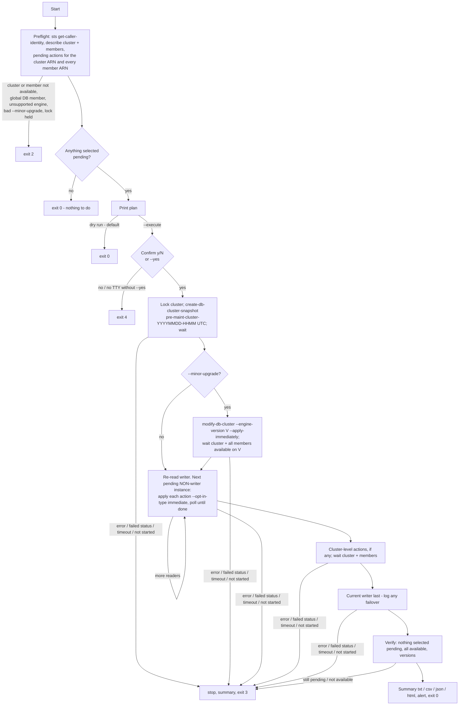

# rds_patch_runner.sh

Applies the **pending maintenance of ONE Aurora cluster** in a safe, logged order. It works with Aurora PostgreSQL and Aurora MySQL, and also with DocumentDB and Neptune clusters. It is the next step after [RDS_Pending_Maintenance](../RDS_Pending_Maintenance/README.md): the report tells you what is pending, and this tool applies it to one cluster at a time.

```
# 1. look first (DEFAULT: dry run, read-only)
./rds_patch_runner.sh -P prod -r us-east-1 -c orders-prod
# 2. patch
./rds_patch_runner.sh -P prod -r us-east-1 -c orders-prod --execute
```

* **Dry run is the default.** Without `--execute` the tool only makes describe calls and prints the plan. A real run needs `--execute` and then a `Patch <cluster>? [y/N]` answer, or `--yes`.
* **Order:** preflight → confirm → cluster snapshot → (optional minor upgrade) → **readers one at a time** → cluster-level actions → **current writer last** → verify → summary.
* **Stops at the first failure.** If a reader fails or times out, the writer is never touched.
* **Requirements:** Bash 4.4+, AWS CLI v2, jq 1.6+, and `timeout` (coreutils). The tool is the main script plus `lib/runner.jq`; keep them together. It runs in AWS CloudShell as is.

## Flow



## Steps in detail

| Step | What happens | Stops with |
|---|---|---|
| 0. Preflight | `describe-db-clusters`, `describe-db-instances --filters Name=db-cluster-id`, and `describe-pending-maintenance-actions --resource-identifier` for the cluster ARN and each member ARN. The plan is built from these. | exit 2 if the cluster or any member is not `available`, if the cluster is in a global database (`GlobalClusterIdentifier`), if the engine is not supported, or if the lock is held. Exit 0 if there is nothing to do. |
| 1. Confirm | `Patch <cluster> (account, region)? [y/N]`. With no terminal and no `--yes`, the run aborts. | exit 4 |
| 2. Snapshot | `create-db-cluster-snapshot` named `pre-maint-<cluster>-<YYYYMMDD-HHMM>` in UTC (sanitised the same way as in the report). Then `timeout <step timeout> aws rds wait db-cluster-snapshot-available`. The CLI waiter gives up after 30 minutes, and DocumentDB/Neptune have no waiter of their own, so the tool then falls back to polling `describe-db-cluster-snapshots`. `--skip-snapshot` skips this step (not recommended). | exit 3 |
| 3. Minor upgrade (optional) | `--minor-upgrade V\|latest`: `modify-db-cluster --engine-version V --apply-immediately`, run right after the snapshot. The tool waits until the cluster and every member are `available` on V. `latest` = the highest non-major `ValidUpgradeTarget` of the current version, and the step is skipped if there is none. An exact V must be one of those targets (exit 2 otherwise). | exit 3 |
| 4. Readers | One instance at a time. For each selected pending action: `apply-pending-maintenance-action --opt-in-type immediate`, then poll (see below). Before each step the tool re-reads the pending actions; if they are already gone, the step is marked `skipped`. | exit 3, writer untouched |
| 5. Cluster-level | Cluster-ARN actions (usually `db-upgrade` / `system-update` on the cluster) are applied **after the readers and before the writer**. The tool waits for the cluster **and all members** to be available. | exit 3 |
| 6. Writer | Always the **current** writer, last. See "Writer and failover" below. | exit 3 |
| 7. Verify | Re-reads everything. It fails if any *selected* action type is still pending or anything is not `available`. Unselected actions are listed and do not fail the run. | exit 3 |

### Polling (instances and the cluster)

* The step is **done** when the status is `available` **and** none of the applied actions are still pending. For a minor upgrade, the engine version must also match.
* **Quick actions:** if the status was never seen leaving `available` but the action is gone, the step is `ok` with the note "quick action".
* **Not started / deferred:** if the status stays `available` while the action is still pending after `--grace-sec` (default 600), the step fails with "not started by AWS". Nothing is guessed.
* **Failed states:** `failed`, `incompatible-*`, `inaccessible-encryption-credentials`, `storage-full` and `restore-error` stop the run.
* **Timeout:** `--timeout-min` (default 60) applies **per step**. When it runs out, the step result is `timeout` and the tool exits 3.

### Writer and failover (decision)

Aurora can fail over while an instance is being patched, and the "writer" is a moving target. Before **every** instance step, the tool re-reads `IsClusterWriter`. It then patches the next pending instance that is **not** the current writer. The current writer is always the last instance patched. Every change of writer is logged as `FAILOVER: writer changed A -> B` and listed in the summary.

* *Failover during the writer step* (A → B, where B is an already-patched reader): logged. A finishes its maintenance as a reader. No extra step is needed.
* *Failover before the writer step* (A → C, where C is unpatched): A is now a reader and is patched next. C, the new writer, is patched last. The tool warns "writer is now C (planned writer was A)".
* The tool never triggers a failover itself and never fails back. If you want the writer back on its original instance, run `failover-db-cluster` yourself afterwards.

### Ctrl-C, signals and the lock

* **SIGINT / SIGTERM:** polling stops. The log records the current step, and any opt-in already accepted by AWS is reported as `STILL RUNNING IN AWS (not cancelled)`. An `immediate` opt-in cannot be withdrawn. The log also lists the instances not yet patched and the command to check the state. The summary is written with result `interrupted`, the lock is released, and the tool exits 130. Re-running is safe: the tool re-reads what is still pending.
* **Lock:** one execute run per profile + region + cluster (`$TMPDIR/rds_patch_runner_locks/<profile>_<region>_<cluster>.lock`, a mkdir lock with a pid file). A lock held by a live pid → exit 2. A stale lock (dead pid) is removed with a warning. Dry runs take no lock. The lock is per host: two different CloudShell sessions do not see each other's locks.

## Options

| Option | Meaning |
|---|---|
| `-c, --cluster ID` | Cluster identifier (required) |
| `-P, --profile` / `-r, --region` | AWS CLI profile / region (`--region` defaults to AWS_REGION or the profile's region) |
| `--dry-run` (default) / `--execute` | Plan only / really apply |
| `-y, --yes` | Do not ask for confirmation (needed without a terminal) |
| `-a, --action LIST` | `all` (default), or for example `system-update`, `db-upgrade`, `os-upgrade`, `system-update,db-upgrade`. Unselected actions stay pending and are listed |
| `--minor-upgrade V\|latest` | Also upgrade to minor version V, right after the snapshot |
| `--skip-snapshot` | No pre-maintenance snapshot |
| `--timeout-min N` | Per-step timeout in minutes (default 60; decimals allowed) |
| `--poll-sec N` | Poll interval (default 30) |
| `--grace-sec N` | "Not started by AWS" grace period (default 600) |
| `-o DIR`, `--html`, `-l FILE` | Output directory (default `./rds_patch_runs`), extra HTML summary, log file |
| `--lock-dir DIR` | Lock directory |
| `--alert-email`, `--alert-webhook`, `--alert-webhook-format slack\|json`, `--alert-on always\|failure`, `--alert-from` | Alerts at the end of execute runs |
| `--config FILE` | key=value file (see `rds_patch_runner.conf.example`). It is parsed, never sourced; CLI options win. `execute`/`yes` and credentials are refused in the file |
| `--aws-timeout`, `--max-attempts`, `-v`, `-h`, `-V` | CLI timeouts / retries, debug, help, version |

## Exit codes

| Code | Meaning |
|---|---|
| 0 | Patched and verified, nothing to do, or dry run |
| 1 | Usage / configuration error |
| 2 | Preflight abort: cluster or member not available, global database member, unsupported engine, invalid `--minor-upgrade`, lock held, AWS read error. **Nothing was changed** |
| 3 | A step failed, timed out or was not started by AWS, or verification failed. Later steps were **not** run |
| 4 | Declined at the prompt, or no terminal and no `--yes`. Nothing changed |
| 130 | Interrupted (SIGINT/SIGTERM) |

## Output

Each execute run writes these files to `-o DIR`:
* `<cluster>_<UTCstamp>.log`: timestamped log including the plan.
* `.summary.txt`, `.summary.csv`, and with `--html` also `.summary.html`: one row per step with start, end, duration, result, before → after version and detail; versions before → after per resource; pending actions left; failovers seen.
* `.json`: everything above, for automation.

See [samples/](samples/): [dry-run plan](samples/dry_run_plan.txt), [execute log with failover](samples/orders-prod_sample.log), [summary txt](samples/orders-prod_sample.summary.txt) / [csv](samples/orders-prod_sample.summary.csv) / [html](samples/orders-prod_sample.summary.html) ([screenshot](samples/sample_summary.png)), and a [reader-failure run](samples/orders-prod_reader_failure_sample.log) ([summary](samples/orders-prod_reader_failure_sample.summary.txt)). All of them come from the mock, not from AWS.

## IAM permissions

A dry run needs only the read actions. `--execute` also needs the write actions.

```json
{
  "Version": "2012-10-17",
  "Statement": [
    {
      "Sid": "ReadForPlanAndPolling",
      "Effect": "Allow",
      "Action": [
        "sts:GetCallerIdentity",
        "rds:DescribeDBClusters",
        "rds:DescribeDBInstances",
        "rds:DescribePendingMaintenanceActions",
        "rds:DescribeDBClusterSnapshots",
        "rds:DescribeDBEngineVersions"
      ],
      "Resource": "*"
    },
    {
      "Sid": "WriteForExecute",
      "Effect": "Allow",
      "Action": [
        "rds:ApplyPendingMaintenanceAction",
        "rds:CreateDBClusterSnapshot",
        "rds:AddTagsToResource",
        "rds:ModifyDBCluster"
      ],
      "Resource": [
        "arn:aws:rds:*:123456789012:cluster:orders-prod",
        "arn:aws:rds:*:123456789012:db:orders-prod-*",
        "arn:aws:rds:*:123456789012:cluster-snapshot:pre-maint-*"
      ]
    }
  ]
}
```

* DocumentDB and Neptune use the same `rds:` IAM actions; the tool calls them through `aws docdb` / `aws neptune`.
* `rds:ModifyDBCluster` is needed only for `--minor-upgrade`. The tool passes no tags, so `rds:AddTagsToResource` is only there for accounts whose SCPs or tag policies make tagging part of create calls; drop it if you don't need it.
* **Encrypted clusters:** a same-account snapshot uses the cluster's KMS key and normally needs no extra KMS permission. If your key policy is restrictive, allow `kms:DescribeKey` and `kms:CreateGrant` on that key for the role.
* Scope the write statement to the clusters you own. Snapshots count against the manual cluster snapshot quota (100 per region by default), and the tool never deletes them.

## Examples

See [EXAMPLES.md](EXAMPLES.md) for dry run, execute, a cron/no-TTY run, action filtering, minor upgrades, DocumentDB, and reading the summary.

## Limitations

* **Single cluster per run.** Run it once per cluster, or loop over clusters yourself; see EXAMPLES.md.
* **No global databases yet.** A member of an Aurora global database is refused with exit 2. Patch the secondaries first, then the primary, by hand.
* **No RDS non-Aurora instances yet** (PostgreSQL, MySQL, MariaDB, SQL Server, Oracle, Db2), and no Multi-AZ DB clusters or Aurora Serverless v1. These are refused with exit 2.
* No blue/green deployments and no major-version upgrades. `--minor-upgrade` refuses major targets.
* Actions are applied with `--opt-in-type immediate` only, and every selected action on an instance is applied in the same step. Instances are not patched in parallel.
* The tool does not stop application traffic and does not drain connections. Readers reboot during their patch and the writer step usually causes a short write outage (or a failover); plan a window.
* The lock is per host (`/tmp`), not per account.
* Clock and timing come from the host; the timeouts are per step, not for the whole run.

## Tests

```
tests/run_tests.sh     # 99 checks against the stateful mock (no AWS)
tests/validate_cli.sh  # replays every generated command through the REAL AWS CLI v2 with fake credentials
                       # and a dead endpoint/proxy, runs negative controls, and checks mock output shapes against the CLI's output skeletons
```

* The mock (`tests/mock/aws`, Python) keeps state in a JSON file. Statuses advance one "tick" per describe call: available → upgrading → rebooting → available, and a snapshot goes creating → available.
* Mock scenarios: `ok failover earlyfailover timeout readererror readerfailed notavailable membernotavailable global nothing quick deferred minor docdb neptune waitgiveup snapfail unsupported clusteronly`.
* **Guard:** the tests put the mock first in `PATH` and refuse to start unless `command -v aws` is the mock and reports `(mock)`. Credentials are fake, config files are `/dev/null`, and `HTTP(S)_PROXY` and `AWS_ENDPOINT_URL` point to the closed port 127.0.0.1:9, so even a stray real `aws` cannot reach AWS. `validate_cli.sh` calls the real CLI only through a wrapper that forces `--endpoint-url http://127.0.0.1:9`.

## Changelog

* 1.0.0: first version.
