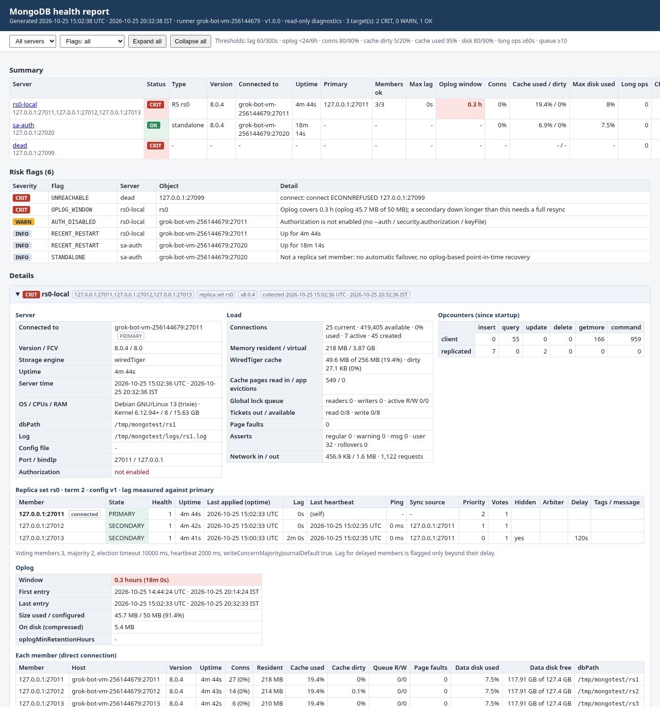

# MongoDB / Health_Check

`mongo_health_report.sh` is a **read-only** health check for MongoDB replica sets and standalones. It covers many servers in one run and writes one self-contained HTML report, with optional CSV and JSON.

Every call is a read: `hello`, `buildInfo`, `hostInfo`, `serverStatus`, `getParameter`, `getCmdLineOpts`, `replSetGetStatus`, `replSetGetConfig`, `currentOp`, `listDatabases`, `dbStats`, `$collStats`, and the first and last entry of `local.oplog.rs`. Commands run with `maxTimeMS` and `readPreference=primaryPreferred`. See [`lib/collect.js`](lib/collect.js). Nothing is written, killed, stepped down or reconfigured. Disk free over SSH runs only `df -PTk` and `df -Pk <path>`.



## What it reports

| Section | Details |
|---|---|
| Summary | one row per target: status (OK / WARN / CRIT), type (replica set / standalone / mongos), version, primary, members up, max lag, oplog window, connections %, data-disk %, flag counts |
| Replica set status | every member from `rs.status()`: state, health, uptime, optime, lag behind the primary (delay-aware for delayed members), sync source, ping, priority / votes / hidden / delay from the config, last heartbeat message |
| Oplog | size, used, first/last entry, window in hours |
| Members (direct) | each member opened directly (unless `--no-members`): version, uptime, connections, WiredTiger cache used / dirty, read/write tickets, queues, data-disk used from `dbStats` |
| Server | host, OS (`hostInfo`), engine, dbPath, log path, opcounters, network, asserts, auth on/off |
| Long-running operations | `currentOp` ops running ≥ `--long-op` seconds (oplog tailing and awaitable `hello` are skipped). The command is shown truncated |
| Databases | size, storage, indexes, objects, per database |
| Top collections | the N largest collections (`--top`), with document count, storage, index size |
| Disk free | data filesystem from `dbStats` (always, no SSH). With `ssh=`, `df -PTk` for every mount on each host plus the filesystem behind each member's dbPath and log directory |

The report header shows the time in UTC and in the local time zone of the machine running it.

**Flags** appear in the summary, sorted by severity:

| Flag | Severity |
|---|---|
| `UNREACHABLE` (connect / auth failed) | CRIT |
| `NO_PRIMARY` | CRIT |
| `NO_MAJORITY` (voting members up < majority) | CRIT |
| `MEMBER_DOWN` | CRIT |
| `MEMBER_STATE` (RECOVERING, ROLLBACK, UNKNOWN, ...) | CRIT |
| `REPL_LAG` (beyond the member's configured delay) | WARN / CRIT (`--lag-warn/--lag-crit`) |
| `OPLOG_WINDOW` | WARN / CRIT (`--oplog-warn/--oplog-crit`) |
| `CONNECTIONS` | WARN / CRIT (`--conn-warn/--conn-crit`) |
| `CACHE_DIRTY` / `CACHE_FULL` | WARN / CRIT, WARN |
| `DISK_DATA_FS` (dbStats filesystem) / `DISK_MOUNT` (df over SSH) | WARN / CRIT (`--disk-warn/--disk-crit`) |
| `AUTH_DISABLED` | WARN |
| `LONG_RUNNING_OPS` | WARN |
| `QUEUED_OPS` / `TICKETS_EXHAUSTED` | WARN |
| `VERSION_MISMATCH` (members on different versions) | WARN |
| `RS_DISCOVERY_FAILED` (replica set connection failed, report built from a direct seed connection) | WARN |
| `RS_STATUS_UNAVAILABLE` | WARN |
| `SSH_DF_FAILED` | WARN |
| `MONGOS` (a mongos was given: only server-level checks run) | WARN |
| `STANDALONE` | INFO |
| `RECENT_RESTART` (up < 1 h) | INFO |
| `EVEN_VOTERS` | INFO |
| `MEMBER_DIRECT_FAILED` | INFO |
| `OPLOG_UNREADABLE` (no `read` on `local`) | INFO |
| `ASSERTS` / `SECTION_ERRORS` | INFO |

An unreachable server, or a section that fails (for example a missing privilege), is recorded in the report and the run continues.

## Servers file

The servers file is parsed and never sourced. Copy [`servers.conf.example`](servers.conf.example). Each line is:

```
# name        uri | host:port[,host:port..]                         [key=value ...]
orders-rs     db1.prod.internal:27017,db2.prod.internal:27017       rs=rs0 user=dba_mon pass_env=MONGO_PW ssh=auto ssh_user=ec2-user
reporting     10.0.2.20:27017                                       user=dba_mon pass_env=MONGO_RPT_PW ssh=ec2-user@10.0.2.20
analytics     mongodb+srv://analytics.abcde.mongodb.net/            user=dba_mon pass_env=ATLAS_PW
```

| Key | Meaning |
|---|---|
| `rs=` | replica set name (added as `replicaSet=` for host lists). List two or more seeds so the report works with one host down |
| `user=` / `authdb=` | monitoring user, auth database (default `admin`) |
| `pass_env=VAR` | password from environment variable `VAR` (recommended) |
| `pass_file=PATH` | password from the first line of `PATH` (`chmod 600`; a warning is printed if group/others can read it) |
| `authmech=` | e.g. `SCRAM-SHA-256`, `MONGODB-X509`, `MONGODB-AWS` |
| `tls=on\|off`, `tlsca=`, `tlscert=`, `tls_insecure=on` | TLS. `mongodb+srv://` turns TLS on by itself |
| `ssh=auto` | run df on every replica set member host (member name, port stripped) |
| `ssh=[user@]host[,..]` | run df on these hosts instead |
| `ssh_user=`, `ssh_port=`, `ssh_key=` | SSH options. `~/` is expanded in path keys |

- **Passwords** are never read from the servers file or the command line. A `mongodb://user:pass@` URI is refused with a hint. The password reaches mongosh only through its environment, and the connection URI is built inside mongosh, so it never appears in `ps`, the log or the outputs. It is visible in `/proc/<pid>/environ` only to the same OS user and root while that server is being collected.
- **SSH** uses `BatchMode=yes`, so keys or an ssh-agent must already work (`ssh user@host true`). Unknown host keys fail unless you pass `--ssh-accept-new`. Amazon Linux usually needs `ssh_user=ec2-user`; RHEL on EC2 also uses `ec2-user`, on-prem RHEL is your own user. `sudo` is never used: `df` needs no root.

## Usage (CloudShell or any Linux host)

```bash
cd ~/DBA && git pull --ff-only
cd MongoDB/Health_Check
cp servers.conf.example servers.conf && vi servers.conf

read -rsp 'MongoDB password: ' MONGO_PW && export MONGO_PW && echo
./mongo_health_report.sh -s servers.conf --dry-run            # check the parsed targets, no connections
./mongo_health_report.sh -s servers.conf -o ~/reports --csv
unset MONGO_PW
```

More examples:

```bash
# one replica set, no servers file
./mongo_health_report.sh -n orders -u db1:27017,db2:27017 --set rs=rs0 --set user=dba_mon --set pass_env=MONGO_PW

# only some targets, tighter disk thresholds, df over SSH on hosts with ssh= set
./mongo_health_report.sh -s servers.conf --only 'orders-*,crm-rs' --disk-warn 70 --disk-crit 85

# cron / monitoring: quiet, exit 5 on any CRIT flag
./mongo_health_report.sh -s servers.conf -o /var/tmp/mongo_reports -q --fail-on crit || echo "check the report"
```

Download the HTML from CloudShell with **Actions → Download file** and the path printed after `Wrote:`. Output files are created with mode 600.

### Options

| Option | Default | Meaning |
|---|---|---|
| `-s, --servers FILE` | | servers file |
| `-u, --uri TARGET` / `-n, --name` / `--set k=v` | | single target instead of `-s` |
| `--only NAME` | all | targets to run (repeatable, comma list, globs) |
| `-o, --output-dir DIR` / `--prefix` | `.` / `mongo_health` | output `<prefix>_YYYYmmdd_HHMMSS.html` |
| `--csv` / `--json` | off | also write `_summary.csv` + `_flags.csv` / the raw collected data |
| `--top N` / `--max-collections N` / `--include-system` | 10 / 500 / off | top collections list |
| `--no-members` | off | do not open each member directly |
| `--ssh` / `--no-ssh` / `--ssh-timeout S` / `--ssh-accept-new` | ssh when `ssh=` set / 10 | df over SSH |
| `--lag-warn/--lag-crit S` | 60 / 300 | replication lag beyond the configured delay |
| `--oplog-warn/--oplog-crit H` | 24 / 6 | oplog window |
| `--conn-warn/--conn-crit %` | 80 / 90 | connections used |
| `--dirty-warn/--dirty-crit %`, `--cache-warn %` | 5 / 20, 95 | WiredTiger cache |
| `--disk-warn/--disk-crit %` | 80 / 90 | filesystem used |
| `--long-op S` / `--queue-warn N` | 60 / 10 | long-running ops / queued ops |
| `--fail-on warn\|crit` | | exit 5 when such a flag is raised |
| `--timeout S` / `--max-time S` / `--server-timeout S` | 10 / 30 / 300 | connect, per-command `maxTimeMS`, whole server |
| `--dry-run` / `--keep-workdir` / `-q` / `-v` | | |

`MONGOSH=/path/to/mongosh` selects a mongosh binary.

### Exit codes

| Code | Meaning |
|---|---|
| 0 | report produced (unreachable servers are CRIT rows in it) |
| 1 | usage / servers file error |
| 2 | pre-check (mongosh, jq, timeout or ssh missing) |
| 3 | no server reachable |
| 4 | output error (output dir not writable, render failed) |
| 5 | a flag at or above `--fail-on` |
| 130 | interrupted |

## Prerequisites

`bash` 4+, `jq` 1.6+, `mongosh` 1.x/2.x (the legacy `mongo` shell is not supported), coreutils `timeout`, and `ssh` for df over SSH. CloudShell has bash and jq; add mongosh as below.

Amazon Linux 2023 / RHEL 8 / RHEL 9 (and CloudShell, which is AL2023):

```bash
sudo tee /etc/yum.repos.d/mongodb-org-8.0.repo <<'REPO'
[mongodb-org-8.0]
name=MongoDB Repository
baseurl=https://repo.mongodb.org/yum/amazon/2023/mongodb-org/8.0/x86_64/
gpgcheck=1
enabled=1
gpgkey=https://pgp.mongodb.com/server-8.0.asc
REPO
sudo dnf install -y mongodb-mongosh jq
```

- RHEL 8 / 9: use `baseurl=https://repo.mongodb.org/yum/redhat/$releasever/mongodb-org/8.0/x86_64/`.
- Amazon Linux 2: `baseurl=https://repo.mongodb.org/yum/amazon/2/mongodb-org/8.0/x86_64/` and `sudo yum install -y mongodb-mongosh jq`.
- On aarch64 (Graviton) replace `x86_64` with `aarch64`.
- If the host has OpenSSL 3 and mongosh complains about it, install `mongodb-mongosh-shared-openssl3` instead.
- CloudShell's home directory survives sessions but `/usr` does not, so the `dnf install` has to be repeated in a new session, or install the mongosh tarball under `~/bin` and set `MONGOSH=~/bin/mongosh`.

## Privileges needed

A dedicated monitoring user with `clusterMonitor` and read on `local` (for the oplog window):

```javascript
use admin
db.createUser({ user: "dba_mon", pwd: passwordPrompt(),
                roles: [ "clusterMonitor", { role: "read", db: "local" } ] })
```

`clusterMonitor` covers `serverStatus`, `replSetGetStatus`, `replSetGetConfig`, `getCmdLineOpts`, `hostInfo`, `currentOp`, `listDatabases`, `dbStats` and `collStats` on all databases. Without `read` on `local` the oplog window is skipped (`OPLOG_UNREADABLE`). Atlas: use the built-in `clusterMonitor` role on a database user.

## Tests

`tests/setup_local.sh` starts a throwaway local test bed (MongoDB 8.0): replica set `rs0` on 28001-28003 (28003 hidden, priority 0, 120 s delayed) with sample data, and an `--auth` standalone on 28010 with the `mon` user (password with `@ : / space`). Nothing runs on 28099.

`tests/run_tests.sh` (67 checks, 73 with SSH) covers shellcheck, a jq compile check, a grep that `collect.js` contains no write or admin-change commands, input validation (injection attempts in the servers file, duplicate names, bad keys, password in URI), a multi-server run with an unreachable target, each common flag, `--fail-on`, wrong / missing / world-readable password file, a long-running query, a member shut down, no primary with only the hidden member left (`RS_DISCOVERY_FAILED`), recovery, CSV/JSON shape, and that the password never shows up in the outputs. With `MHR_TEST_SSH_PORT` (and `MHR_TEST_SSH_KEY`) set it also tests df over SSH against `127.0.0.1`.

```bash
tests/setup_local.sh && tests/run_tests.sh       # tests/setup_local.sh stop  when done
```

## Limits

- Tested on local MongoDB 8.0 with mongosh 2.3 and jq 1.7, **not yet on real Amazon Linux / RHEL servers, Atlas, TLS/x509, or a sharded cluster**. Please try one non-prod replica set first.
- Sharded clusters: pointing at a `mongos` gives server-level checks only (`MONGOS` flag). List each shard's replica set and the config server replica set as their own targets.
- Lag is measured from `rs.status()` optimes, so it is as fresh as the last heartbeat (about 2 s).
- The data-disk figure from `dbStats` is the filesystem holding the dbPath. Separate journal, log or index volumes are only seen with `ssh=`.
- On Atlas and other managed services there is no SSH and some commands (`getCmdLineOpts`, `hostInfo`) may be refused; those sections show the error and the rest of the report is produced.
- Very many collections: collection stats stop after `--max-collections` per server.
