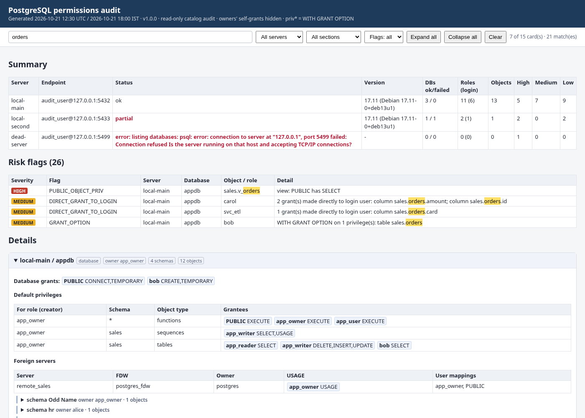

# Postgres / Permissions_Audit

`pg_permissions_audit.sh` is a **read-only** permissions audit for Aurora PostgreSQL and RDS/community PostgreSQL. It covers many servers and databases in one run.

Every query is a `SELECT` on `pg_catalog` (see [`lib/audit.sql`](lib/audit.sql)). Each session is opened with `default_transaction_read_only=on`, `statement_timeout`, `lock_timeout=5s` and `search_path=pg_catalog`. Nothing is granted, revoked or changed.



## What it reports

| Level | Details |
|---|---|
| Database | owner, connection limit, CONNECT / CREATE / TEMPORARY grants (incl. PUBLIC, default ACL marked) |
| Schema | owner, USAGE / CREATE grants incl. PUBLIC, extension-owned schemas marked |
| Objects | tables, partitioned tables, views, matviews, sequences, foreign tables, functions, procedures, aggregates: owner, every grant, `*` = WITH GRANT OPTION, SECURITY DEFINER marked |
| Columns | column-level grants (`GRANT SELECT (col) ...`) |
| Default privileges | every `ALTER DEFAULT PRIVILEGES` rule: creator role, schema (`*` = all schemas), object type, grantee, privileges |
| Foreign data | foreign servers, USAGE grants, user mappings (user names only, **never** the mapping options/passwords) |
| Roles | login, rds_superuser membership, superuser, CREATEROLE/CREATEDB, inherit, connection limit, VALID UNTIL, member of / members |
| Membership chains | recursive, for example `alice -> app_user -> app_writer -> app_reader`. Inherited roles and "SET ROLE only" roles (NOINHERIT) are listed separately |
| Per-role access | for a role: everything it can reach directly, through inherited group roles and through PUBLIC. Each grant shows which role it comes **via**. Owned objects and future objects (default privileges) are included |

**Risk flags** appear in the summary, sorted by severity:

| Flag | Severity |
|---|---|
| `PUBLIC_CREATE_PUBLIC_SCHEMA` | HIGH |
| `PUBLIC_OBJECT_PRIV` (table/view/sequence privilege to PUBLIC) | HIGH |
| `PUBLIC_EXEC_SECDEF` (SECURITY DEFINER callable by PUBLIC) | HIGH |
| `RDS_SUPERUSER_MEMBER` | HIGH |
| `SUPERUSER` | HIGH |
| `SERVER_ERROR` / `DB_ERROR` | HIGH |
| `DIRECT_GRANT_TO_LOGIN` (grants made to users instead of roles, incl. default privileges and column grants) | MEDIUM |
| `GRANT_OPTION` | MEDIUM |
| `PASSWORD_EXPIRED` | MEDIUM |
| `LOGIN_WITH_CREATEROLE_DB` | MEDIUM |
| `PUBLIC_SCHEMA_PRIV` (non-public schema) | MEDIUM |
| `PUBLIC_DB_CREATE` | MEDIUM |
| `OWNED_BY_LOGIN_USER` | LOW |
| `SCHEMA_OWNED_BY_LOGIN_USER` | LOW |
| `UNUSED_GROUP_ROLE` (NOLOGIN, no members) | LOW |
| `PASSWORD_NO_EXPIRY` | LOW |
| `PUBLIC_EXECUTE` (explicit) | LOW |

Some things are left out on purpose:

- Owners' implicit self-grants are hidden. Use `--show-owner-grants` to show them; they are always in the JSON.
- Extension-owned objects (for example postgres_fdw's functions) are skipped.
- PostgreSQL's built-in `EXECUTE to PUBLIC` on functions is not flagged unless the function is SECURITY DEFINER.
- System roles (`pg_*`, `rds*`, OID < 16384) are never flagged.

## Servers file

The servers file is parsed and never sourced. Copy `servers.conf.example`. Each line is:

```
# name          host                                                      port user      dbs        [sslmode] [auth=..] [region=..]
billing-prod    billing-prod.cluster-abc123xyz.us-east-1.rds.amazonaws.com 5432 dba_audit all        require
crm-prod        crm-prod.cluster-abc123xyz.ap-south-1.rds.amazonaws.com    5432 dba_audit crm,crm_rpt require auth=iam
```

- **dbs**: `all` means every connectable, non-template database you have CONNECT on, with `rdsadmin` always skipped. Or give a comma list.
- **Passwords**: `~/.pgpass` (recommended, `chmod 600`) or `PGPASSWORD`. Never put passwords in the servers file.
- **IAM**: `auth=iam` calls `aws rds generate-db-auth-token` (the region is parsed from the host, or set `region=`/`AWS_REGION`). The token is passed to psql only through the environment, and sslmode defaults to `require`.
- **Failures**: an unreachable server, a failed login or a missing database is recorded in the report (summary + `SERVER_ERROR`/`DB_ERROR` flags) and the run continues.

## Usage (CloudShell)

```bash
cd ~/DBA && git pull --ff-only
cd Postgres/Permissions_Audit
sudo dnf install -y postgresql15            # once, if psql is missing (jq is preinstalled)
cp servers.conf.example ~/pg_servers.conf    # edit; keep it outside the repo

./pg_permissions_audit.sh -s ~/pg_servers.conf --dry-run                       # check parsing, no connections
./pg_permissions_audit.sh -s ~/pg_servers.conf | less -S                         # text to screen
./pg_permissions_audit.sh -s ~/pg_servers.conf -F text,csv,json,html -o ~/audit  # all formats
./pg_permissions_audit.sh -s ~/pg_servers.conf --role app_user,alice -F html -o ~/audit   # per-role view + only grants that reach them
./pg_permissions_audit.sh -h mycluster.cluster-xyz.us-east-1.rds.amazonaws.com -U dba_audit -d app --sslmode require
./pg_permissions_audit.sh -h mycluster... -U dba_iam --iam -d all --schema 'sales*,hr'
./pg_permissions_audit.sh -s ~/pg_servers.conf --db 'prod_*' --include-system
```

| Option | Meaning |
|---|---|
| `-s FILE` / `-h -p -U -d -n` | targets (servers file or one server) |
| `--sslmode`, `--iam`, `--region` | single-server connection settings |
| `--db GLOB` | database filter |
| `--schema GLOB` | schema filter |
| `--role NAME` | per-role view for these roles, and restricts grants to roles that reach them (repeatable or comma lists) |
| `--include-system` | include pg_catalog / information_schema / pg_toast (default: excluded) |
| `--show-owner-grants` | show the owner's own grants |
| `-F text,csv,json,html -o DIR` | output formats and directory. csv writes `_grants`, `_roles`, `_flags` and `_summary` |
| `--top N` | examples per flag in the text summary |
| `--connect-timeout`, `--statement-timeout` | timeouts (10s / 120s) |
| `--keep-workdir` | keep the raw per-database JSON |
| `-v` | verbose |

Without `--role`, the JSON and HTML include a per-role access view for every non-system login role. The text report shows it only for the roles named with `--role`.

**HTML report:** a single self-contained file with no network access. It has a summary, a flag table and cards grouped **server → database → schema**, plus a roles card and per-role access cards for each server.

- `/` focuses the search. Search matches any text (server, database, schema, object, role, privilege, error), highlights the hits, opens the matching cards and schemas, and `Esc` clears it.
- Filters: server, section (databases / roles / per-role access) and flag severity.
- Expand all / Collapse all buttons.

Exit codes:

| Code | Meaning |
|---|---|
| 0 | report produced (check it for failed servers/databases) |
| 1 | usage |
| 2 | pre-check |
| 3 | no database could be audited |
| 4 | output error |
| 130 | interrupted |

## Privileges needed

Any login role that can CONNECT to the databases can read these catalogs. An `rds_superuser` member, or a dedicated `dba_audit` role with CONNECT, sees everything.

pg_catalog ACLs are visible to all roles, so the audit does not depend on the grants of the role running it. It does **not** read `pg_authid`, password hashes or user-mapping options.

## Tests

`tests/run_tests.sh` (91 checks) runs against **local** PostgreSQL clusters:

- port 5432 loaded with `tests/fixture.sql`: roles, role chains, NOINHERIT, schemas incl. a quoted name, every object type, column grants, default privileges, postgres_fdw server, user mappings and foreign table
- port 5433 loaded with `tests/fixture2.sql`
- an unreachable port, 5499
- `tests/mock/aws` for the IAM token path

It covers shellcheck, input validation (injection attempts in the servers file), each flag, filters, per-role access, CSV/JSON shape and the headless-Chrome HTML check (`tests/html_check.js`, which needs `NODE_PATH` with puppeteer-core).

## Limits

- Tested on PostgreSQL 17 locally, **not yet on a real Aurora PostgreSQL cluster**. The catalog columns used exist in PG 11+ (Aurora 13-16 should work), but please try one non-prod cluster first.
- Effective access is privilege-based. It does not evaluate row-level security policies, `pg_hba`/security groups, or `rds.restrict_password_commands`.
- Types, domains, languages, large objects and event triggers are not audited.
- `PASSWORD_NO_EXPIRY` cannot tell IAM-only users apart (they have no password). Treat it as informational for `rds_iam` members.
- Very large schemas (100k+ objects) produce big HTML. Use `--schema` or `--role` to narrow the report.
